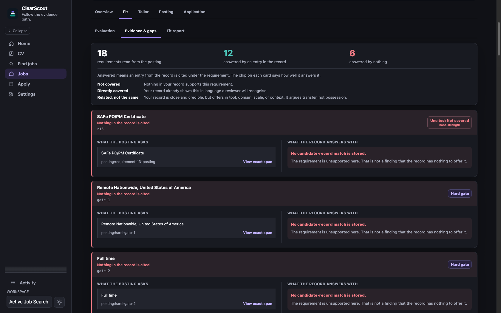
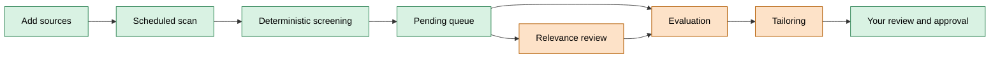
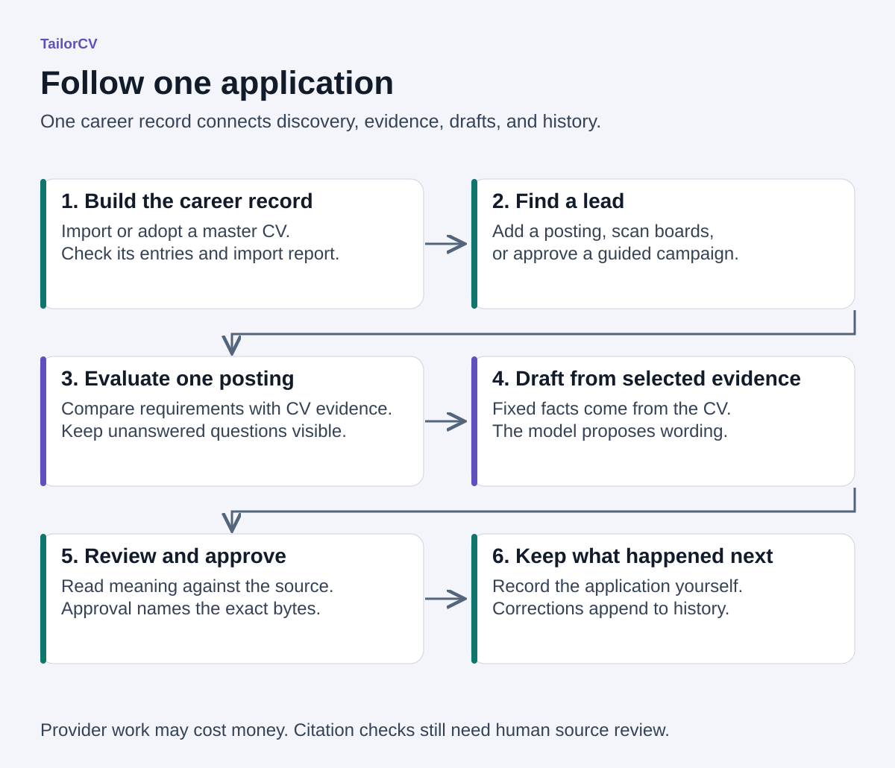
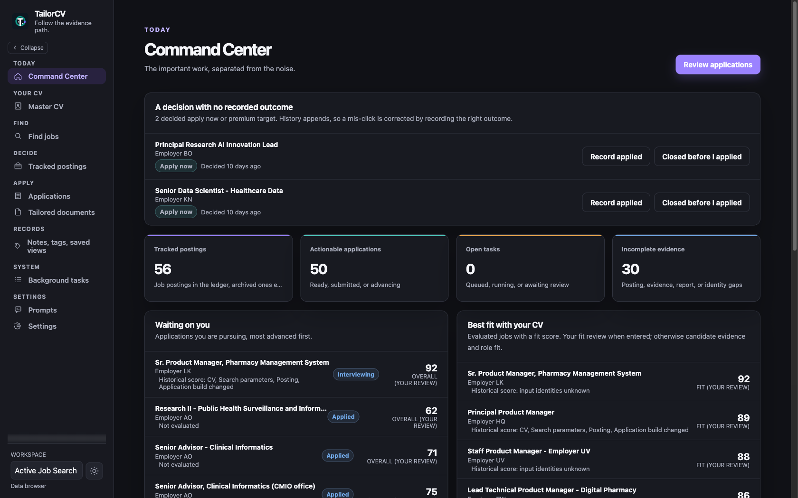

# TailorCV

TailorCV is a local, open-source workspace for finding and tracking jobs,
comparing postings with one master CV, and drafting resumes and cover letters.
The source behind each drafted claim stays close enough to check.

Anti-fabrication is the point. A model may select and reorder CV evidence, but
it may cite only evidence identifiers that exist in the CV selected for that
run. The program copies titles, employers, dates, education, and publication
citations verbatim. A deterministic reader reports its own reading of each
posting beside the model's, and where they disagree, both are shown. Everything
is stored locally, and discovery reads published job feeds under the policy
each site publishes.

Start with free discovery: create a workspace, enter search preferences, add
posting links or employer boards, and track jobs with your own notes. No CV or
provider key is needed. Optional daily or weekly scans run while the local
worker is running. Evaluation and drafting are separate paid actions, and the
[free and paid paths](docs/user-guide.md#choose-the-free-or-paid-path) show
where provider charges begin.



The evaluation keeps the posting's words, the cited CV entry, and an unsupported
answer apart. A high score elsewhere cannot turn missing evidence into a claim.

Version 0.1.0 is an alpha for technical early adopters. Downloadable builds use
[tagged releases](#install-a-tagged-release); a source checkout is a contributor
environment, not an installed product. To look before installing, read the
[product tour](docs/product-tour.md), whose screenshots come from a redacted
working workspace, or [run the synthetic workspace](#try-the-synthetic-workspace).

TailorCV identifies itself with its own user agent and honors robots.txt for
board reads, refreshes, and every later read of a stored URL. The one exception
is the first read of a posting link you enter yourself, which proceeds unless
robots.txt names TailorCV. Each user is responsible for following the terms of
the sites they read with it.

## Free and paid

TailorCV works fully free as a board scanner and screener. No provider key is
needed to add boards, scan them on a schedule, screen postings with
deterministic rules, and track jobs. Paid steps are opt-in. Each one sends a
bounded input to the OpenAI or Anthropic account you configure. Nothing the
program schedules by itself is paid; every paid task starts with a person.

| Operation                                   | Cost | Model stages                         |
| ------------------------------------------- | ---- | ------------------------------------ |
| Add, preview, schedule, and scan boards     | Free | None                                 |
| Add a posting link, refresh, track, dismiss | Free | None                                 |
| Adopt a canonical Markdown or text CV       | Free | None                                 |
| Import a Word, PDF, image, or other CV      | Paid | STRUCTURE, INGEST                    |
| Relevance review of selected postings       | Paid | RELEVANCE_REVIEW, up to 20 per call  |
| Evaluate a posting                          | Paid | JOBSPEC, MATCH                       |
| Tailor a resume and cover letter            | Paid | JOBSPEC, MATCH, DRAFT, COVER, CRITIC |
| Search vocabulary or a guided campaign      | Paid | Vocabulary, hosted web search        |

The [full table](docs/user-guide.md#choose-the-free-or-paid-path) lists every
operation, and [typical costs](docs/user-guide.md#typical-costs) gives measured
numbers. [What live runs cost and taught](evals/FINDINGS.md) explains the
model lessons, and [evaluation results](evals/RESULTS.md) holds the tables.



Green steps are free. Orange steps are paid and optional.

## Install a tagged release

Install [uv](https://docs.astral.sh/uv/getting-started/installation/) first.
The wheel requires Python 3.12 or newer; uv can provision its Python runtime.
Node, npm, and a source checkout are not needed for the wheel.

When a tagged alpha is published, download its wheel, source archive, and `SHA256SUMS` from
[GitHub Releases](https://github.com/sethstraw/tailorcv/releases). Verify the checksum and build provenance,
then install the wheel. The provenance command below requires the
[GitHub CLI](https://cli.github.com/). The installation workflow targets macOS
and Ubuntu; both must pass on the release revision before publication. Windows
is not checked. The checksum command below is the macOS form; on Linux use
`sha256sum -c SHA256SUMS`.

```bash
shasum -a 256 -c SHA256SUMS
gh attestation verify ./tailorcv-*.whl --repo sethstraw/tailorcv
uv tool install ./tailorcv-*.whl
```

TailorCV is not published to PyPI, and direct Git installation is not
supported. The release workflow builds the web client into the wheel; the Git
checkout does not carry that generated bundle.

Some job pages publish their posting only through JavaScript. TailorCV reads
those in a headless browser: an installed Google Chrome first, then Microsoft
Edge, then a Chromium installed through Playwright. With none of them, those
rendered reads fail and every other read still works.

### Update or remove

To update, stop TailorCV and back up the database with its matching artifacts
and workspace files. [Storage and portability](docs/storage-and-portability.md#sqlite-backup-and-same-root-restore)
explains what the backup must include. Download and verify the new release,
then replace the installed tool:

```bash
tailorcv stop
tailorcv db backup ./tailorcv-before-update.sqlite3
uv tool install --force ./tailorcv-*.whl
tailorcv db upgrade
tailorcv start
tailorcv status
```

Keep only the wheel being installed in the current directory. Use the same
data root and configuration after an update. Read the release's upgrade notes
before changing storage; preserve the backup until the new version is checked.

A database created before the first release tag needs a fresh migrated target
and verified import when its schema changes. Follow
[Migrating](docs/contributing/database-and-migrations.md#migrating) before updating;
`db upgrade` alone cannot update a changed pre-release `v0001` schema.

To remove the application while keeping your search records:

```bash
tailorcv stop
uv tool uninstall tailorcv
```

The database, artifacts, and workspace files remain in the local data root.
Uninstalling does not delete them or revoke provider credentials.

## Start TailorCV

For free discovery, initialize the local database and start TailorCV:

```bash
tailorcv db upgrade
tailorcv start
```

Open the printed URL and create a workspace. A provider key and CV are optional
for discovery. Add posting links, or save target titles before scanning boards.
[Choose a source or posting link](docs/user-guide.md#how-to-choose-a-link).

For evaluation and drafting, import a master CV. Ordinary
Word, PDF, text, or image intake uses a separately billed provider account.
Initialization asks for provider access when needed. Invoking it with an
ordinary CV starts paid restructuring; there is no separate cost-confirmation
step. A canonical TailorCV Markdown CV is adopted without a model call.

```bash
tailorcv init --cv ./Existing_CV.docx --name "My Job Search" --slug my-search
tailorcv start
```

`tailorcv start` starts the loopback server and one durable worker against the
same data root. Use `tailorcv status` to inspect them and `tailorcv stop` to
stop them. Neither process runs a schema migration implicitly. Runtime output is
appended to `tailorcv-serve.log` and `tailorcv-worker.log` in the ignored
`.tailorcv-runtime` directory under the data root.

In a source checkout on macOS, double-click `Start TailorCV.command` to run the
server and worker together and open the browser, and `Stop TailorCV.command` to
stop them. These launchers use the ignored `local-data/` directory in the
checkout unless `TAILORCV_DATA_ROOT` is exported, not the Documents root the
installed command uses. Initialize that root once first:

```bash
uv run tailorcv db upgrade --data-root local-data
```

The [user guide](docs/user-guide.md) follows the complete local workflow.
`tailorcv --help` and `tailorcv <command> --help` are the command reference.

## Try the synthetic workspace

Python 3.12 or newer, Node 24, npm 11, Git, and
[uv](https://docs.astral.sh/uv/) are required. `mise install` provisions
Python 3.12, Node 24, and the latest uv from `mise.toml`; `just --list` shows the common commands
(`just gate`, `just test`, `just gen`, `just serve`, `just fmt`, ...)
that wrap `scripts/gate.sh` and friends. `mise` and `just` are optional helpers.
Open a terminal and clone the repository, then enter its directory:

```bash
git clone https://github.com/sethstraw/tailorcv.git
cd tailorcv
```

Run the following commands from its root, one at a time:

```bash
npm ci --prefix web
npm run --prefix web build
uv sync --all-groups
uv run python scripts/seed_demo_workspace.py --data-root /tmp/tailorcv-demo
uv run tailorcv serve --data-root /tmp/tailorcv-demo
```

Open `http://127.0.0.1:8765`. The demo seed uses invented people, employers,
postings, scores, provider records, costs, and documents. It makes no provider
or job-board request and costs nothing.

The seeded workspace is for evaluation, screenshots, and contributor work. Do
not replace it with a real CV in a development checkout.
[CONTRIBUTING.md](CONTRIBUTING.md) owns the complete clone and verification
path.

## Known limits

[Known limits in 0.1.0](docs/validation.md#known-limits-in-010) owns the full
list. The ones to know before starting:

- Only the OpenAI path has run against a live provider. Anthropic is covered by
  offline contract tests, and guided campaigns need OpenAI.
  [Provider claims](docs/validation.md#provider-claims-are-deliberately-uneven)
  separates the two.
- CV ingestion is not yet well tested across real-world CV formats. The master
  CV must parse as TailorCV's standardized Markdown before its evidence reaches
  evaluation and drafting. Start with `tailorcv template`, and read the
  [CV ingestion limits](docs/validation.md#cv-ingestion-remains-a-limitation).
- Cost estimates advise and never stop a confirmed task.
  [ADR 0026](docs/architecture-decisions/0026-costs-never-stop-approved-work.md)
  explains why.
- Citation checks do not prove that a drafted sentence preserves every
  qualification. Read every line before you send it.
- Board recognition does not guarantee complete board coverage, and Windows is
  not checked.

## Keeping the search together

A spreadsheet can remember application status. A chatbot can compare and
rewrite. A folder can hold document versions. None of them alone keeps the
posting, the CV evidence, the generated claim, the approval, and a later
correction tied together.

Free discovery keeps postings, your priorities, application events, and
submitted files together. When you want model assistance, the paid path adds
CV evidence and reviewed drafts to that record:



1. Import one detailed master CV as the evidence source.
2. Find a posting or add one you already have.
3. Read the fit, cited evidence, and unanswered requirements.
4. Draft from the evidence selected for that job.
5. Approve the exact result and retain what happened next.

It drafts. It does not submit applications, contact employers, look up people,
or decide whether you should apply.

Discovery, posting observations, fit evaluations, tailored documents,
approvals, application events, and corrections belong to the same workspace.
Evaluations and histories append instead of quietly replacing earlier results,
so a changed posting or corrected application status remains visible. The
command center separates jobs that need action from jobs that merely score well
against the CV:



## A generated claim remains checkable

The program copies titles, employers, dates, credentials, and publication
citations from the selected CV, and every drafted line carries the evidence
identifiers that support it. When the record does not answer a requirement,
TailorCV says `not stated` instead of filling the gap.
[Truth, evidence, abstention, and approval](docs/truth-and-provenance.md) owns
the complete rule.

## How the rule is enforced

The rule is enforced by construction, not by asking the model nicely. The CV
parser gives every usable entry a content-derived identifier. Each response
schema is built at runtime as a closed list of those identifiers. Matching can
cite only identifiers that exist. Drafting can cite only the ones selection kept
for that run. A citation to an entry outside the run cannot be expressed, so
nothing has to catch it.

The same habit runs through the rest of the program:

- Every requirement and hard gate quotes the posting. The quote is placed in the
  fetched body before the run continues. One that cannot be placed is held for a
  person.
- A deterministic reader works from the raw posting, not from the model's
  summary of it. Its reading is printed beside the model's. There is no merge
  and no tiebreak, because the disagreement is the useful row.
- Each prompt file marks regions as fixed. An edited prompt that changes one is
  refused at save and again before sending.
- Cost estimates advise. They never stop a task you confirmed.
- Postings are identified by URL. Robots.txt and each source's published
  condition decide what may be read. A model may propose a URL, and local policy
  decides whether to open it.
- The server binds to loopback only, and a provider key never reaches the
  browser.
- The live OpenAI run is committed as a cassette and replayed through the real
  SDK in the offline suite.

Abstention is the feature. An analyzer that says "not stated" three times in
ten is a better instrument than one that always answers. Those three rows are
the ones worth a person's time. [Architecture](ARCHITECTURE.md#the-truth-boundary) explains the
design in full.

## Local policy decides

The model interprets, searches, drafts, and critiques. Application code owns the
workflow, selected evidence, URL-reading policy, deterministic checks, approval,
and cost accounting.

The database, artifacts, postings, notes, and provider-usage records stay under
a private local data root. Model-backed work sends the bounded input for that
stage to the provider you configured and may cost money.
[Security](SECURITY.md#what-leaves-your-computer) lists every request that
leaves the machine. Reading local reports and records makes none.

In the web client, every paid background task shows its scope and cost
information and asks before it is queued. The CLI and the raw API do not ask:
`tailorcv tasks tailor`, a direct `POST /api/v1/tasks`, and an API retry of a
failed paid task enqueue paid work with no confirmation. The Model spend report records
usage and costs from calls that ran. Missing prices remain unknown, and
provider invoices may differ.

Search-vocabulary suggestions use CV evidence. Hosted web search and the
separate free scan of registered sources discover new postings. Both official
provider adapters keep their normal supported request paths; pricing estimates
do not restrict model or endpoint selection.

## Decide whether it fits

| TailorCV fits when                                                           | Choose something else when                                  |
| ---------------------------------------------------------------------------- | ----------------------------------------------------------- |
| You want to inspect the evidence behind every draft.                         | You want a hosted service with no local setup.              |
| You want free discovery, with optional CV-based evaluation and drafting.     | You want to create a short resume from scratch.             |
| You want discovery, evaluation, tailoring, and application history together. | You want automatic submission or application-form autofill. |
| You are comfortable choosing a provider and running a local application.     | You want a browser-only product with bundled AI usage.      |

TailorCV is not a universal ATS scorer, an autonomous job-search agent, or a
document renderer. The separate `pressume` project can render approved Markdown.
TailorCV does not bundle or depend on it, and rendering remains an explicit
external step.

## Why a clinician built a resume tool

I built TailorCV for my own job search. My background is in clinical and health
data, and I taught myself the engineering along the way.

Clinical documentation runs on one rule: if it is not charted, it did not
happen. I could not stop applying that rule to resumes. TailorCV requires
drafted claims to cite the selected CV evidence. I still read the wording.

DrugBank deserves credit for the review habits behind this. Curating drug data
meant checking sources, comparing independent readings, and recording why a
disagreement was resolved. The development reviews and prompt evaluation labels
borrow from that practice. [Why panels](docs/contributing/agent-workflow.md#why-panels)
explains what carries over and where the analogy ends.

That job search is also the beta test. The most demanding user I know is also
the least objective one. My experience using it is not independent evidence
that it will help someone else get hired.

## For reviewers

- [Architecture](ARCHITECTURE.md): package direction, durable state, provider
  calls, and prompts, with the
  [architecture decision records](docs/architecture-decisions/README.md).
- [Validation status](docs/validation.md): what the code, scripts, browser, and
  live runs have and have not established.
- [Truth and provenance](docs/truth-and-provenance.md): the evidence and
  approval model.
- [Security](SECURITY.md) and [privacy and retention](docs/privacy-and-retention.md):
  what leaves the machine and what stays.
- [Prompts](prompts/README.md) and [evaluations](evals/README.md): read them
  without running the application.

## For contributors

- [CONTRIBUTING.md](CONTRIBUTING.md): setup, the public gate, and pull requests.
- [Backend development](docs/contributing/backend-development.md),
  [frontend development](docs/contributing/frontend-development.md), and
  [database and migrations](docs/contributing/database-and-migrations.md).
- [What the public checks can prove](docs/contributing/test-coverage-map.md).
- [How it was built](docs/contributing/agent-workflow.md) and
  [AI-assisted development](docs/contributing/ai-assisted-development.md).
- [Storage and portability](docs/storage-and-portability.md) and
  [support](SUPPORT.md).

## AI assistance and license

Claude and Codex wrote a lot of this: code, tests, and prose. I decided what
the program is allowed to claim and read what they produced. The gate checks
the parts its tests can exercise. It cannot decide whether every sentence is
fair to its source. That still takes reading, in the code and in a resume.

Most rules in AGENTS.md exist because an agent broke something once. A few
exist because I did.

[How it was built](docs/contributing/agent-workflow.md) shows the setup: the
roles, the review agents, the hooks that refuse bad habits, the
one-writer-per-file rule, and why the reviews run as panels.
[Borrowed patterns](ARCHITECTURE.md#borrowed-patterns-and-the-ones-left-out)
covers the model inside the app: which published patterns it follows, and which
it leaves out on purpose. The contribution policy is in
[AI-assisted development](docs/contributing/ai-assisted-development.md).

TailorCV's own code and assets are Apache-2.0. The gate audits the resolved Python and
web dependency trees, and the release carries generated notices and license
texts. That is an engineering review, not legal advice.
