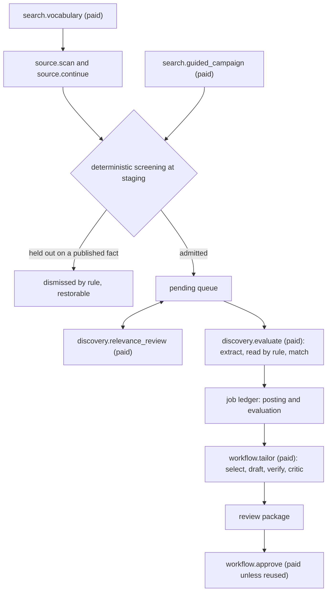
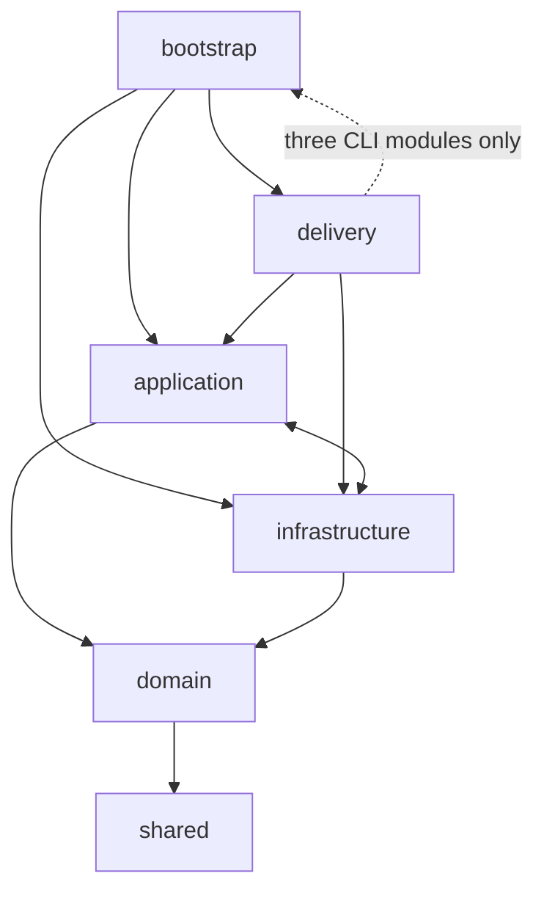
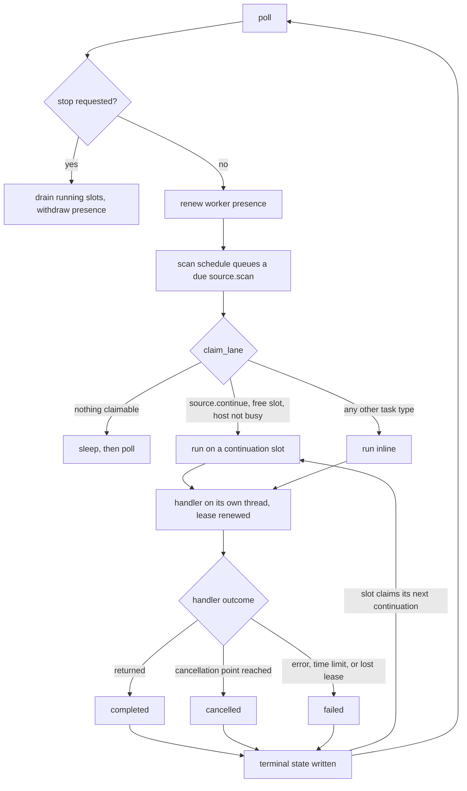
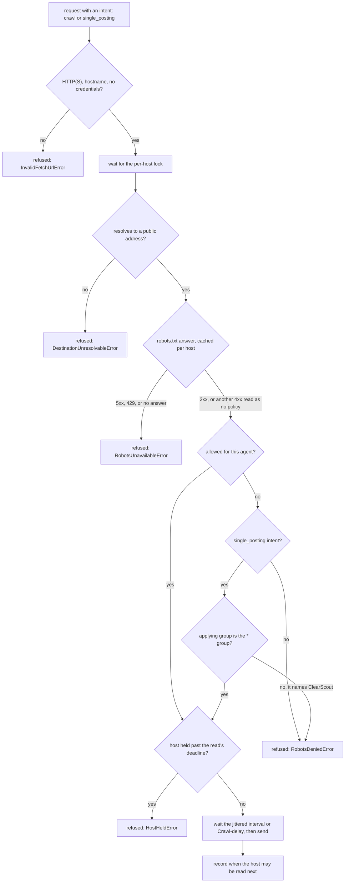
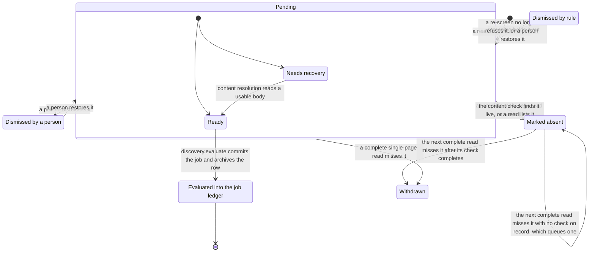
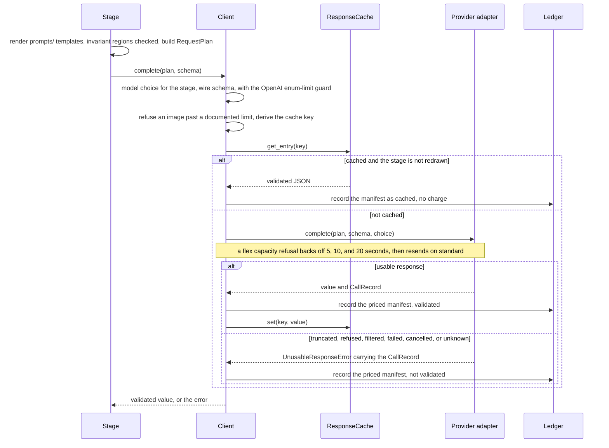

# How ClearScout works

Notes for maintainers. [README.md](../README.md) is the public front door.
[SECURITY.md](../.github/SECURITY.md) owns the threat boundary.
[docs/truth-and-provenance.md](truth-and-provenance.md) owns the evidence
model. This file covers how the parts hold those rules: package direction,
durable state, generated contracts, provider calls, prompts, and artifacts.

## Why it is shaped this way

Anti-fabrication is the product. A tailored resume is useful only if every line
is true, so the program makes that checkable. The model may cite only evidence
identifiers that exist for the run. The program copies titles, employers,
dates, education, and publication citations verbatim; the model never writes them. The model drafts and
critiques. Selection, stage order, and every check stay in application code.

It runs on one computer. The database, files, and queue are local. Only the
provider calls a person starts and the reads published policy allows leave the
machine. Published policy means a board's API terms and robots.txt, with one
exemption for a posting URL a person enters.

There is no autonomous agent. The workflows are fixed. Python picks the next
stage, and the model does bounded interpretation and writing. Assembly, checks,
reporting, and file writes are ordinary code. An agent that chooses its own
path also chooses what it can skip, and someone signs their name to this
output.

The interesting parts, if you only read a few sections:

- [Two readings of one posting, reported apart](#two-readings-of-one-posting-reported-apart):
  a deterministic reader runs beside the model, and disagreements are shown,
  not resolved.
- [The truth boundary](#the-truth-boundary) and
  [Review does not widen the boundary](#review-does-not-widen-the-boundary):
  how a claim is tied to evidence and kept there through approval.
- [Identifying a board is not scraping a page](#identifying-a-board-is-not-scraping-a-page):
  platform adapters, the fetch policy, and the robots exemption.
- [What reaches the queue, and what leaves it](#what-reaches-the-queue-and-what-leaves-it):
  admission on published facts only, and withdrawal only after a complete read.
- [Hosted search proposes; local policy decides](#hosted-search-proposes-local-policy-decides):
  paid search whose bounds size the plan but never stop approved work.
- [Untrusted input](#untrusted-input) and
  [Why the prompt suite is shaped this way](#why-the-prompt-suite-is-shaped-this-way):
  prompts as versioned files, one declared data boundary, and invariant regions
  an override cannot drop.

## The pipeline

In a workspace, each step of the loop is a queued task. A task marked paid can
reach a billing provider. Every other step is code and policy-permitted reads.

_Task names and the paid flag are `TASK_SPECS` in `application/tasks/registry.py`;
staging and screening are `application/discovery/scan_staging/` and
`application/discovery/screening/`._

The file-based `screen` and `run` commands run evaluation and tailoring
directly, without the queue.

| Step    | Main code                                  | Purpose                                                     |
| ------- | ------------------------------------------ | ----------------------------------------------------------- |
| Ingest  | `infrastructure/web_fetch/ingest/`         | Read a URL, text file, PDF, or image                        |
| Extract | `application/tailoring/stages/jobspec.py`  | Turn the posting into structured requirements               |
| Read    | `application/tailoring/fit/`               | Derive the same facts from the raw text by rule, or abstain |
| Match   | `application/tailoring/stages/match.py`    | Link each requirement to CV evidence or a gap               |
| Select  | `application/tailoring/stages/select.py`   | Rank supported evidence within the length budget            |
| Draft   | `application/tailoring/stages/draft.py`    | Draft prose from selected evidence, assemble Markdown       |
| Verify  | `application/tailoring/stages/verify/`     | Run deterministic checks and the model critic               |
| Review  | `application/tailoring/changes/`           | Record every proposed line, its sources, and a digest       |
| Approve | `application/tailoring/approval.py`        | Apply a reviewer's decisions, or refuse them                |
| Report  | `application/tailoring/pipeline/report.py` | Write the review package and provenance table               |

Two commands sit beside the pipeline. `application/tailoring/batch/` screens
each posting once and compares the results. `application/tailoring/elicit/`
asks the person about gaps and can add what they confirm to the master CV.
Neither drafts. Elicitation makes no model call.

`application/master_cv/` is the shared intake for CLI and HTTP onboarding. It
adopts already-conforming Markdown without a model call. Every other source
goes through `application.tailoring.pipeline.import_cv`, with its numbered
citations, authenticity check, loss check, and audit report. Only a passing
canonical document becomes an immutable master-CV version.

`application/tailoring/pipeline/` connects the steps and shares one bounded
rewrite loop. The resume and cover letter are drafted, checked, and rewritten
within one attempt budget, and both are written at the end, pass or fail.
`screen` stops after matching; `run` continues. Provider code lives under
`infrastructure/providers/`. Prompts are versioned files under `prompts/` that
ship with the package, documented in [prompts/README.md](../prompts/README.md).

## Borrowed patterns, and the ones left out

The model work follows published patterns, picked as much for what they rule
out as for what they add.

Anthropic's
[Building effective agents](https://www.anthropic.com/engineering/building-effective-agents)
separates workflows, where code decides the path, from agents, which direct
themselves, and recommends the simplest that works. ClearScout is a workflow.
`pipeline/service.py` calls ingest, extraction, the deterministic reading,
matching, and selection in a fixed order. Each stage reads the structured
output of the one before. The guide calls that prompt chaining.

Drafting is a [Self-Refine](https://arxiv.org/abs/2303.17651) loop: draft,
check, rewrite. `pipeline/rewrite.py` runs the deterministic checks first. The
model critic runs only when those pass and the draft is risky. The loop stops
on a pass, a repeated failure, or a spent attempt budget.

A draft is risky in three cases: it is a rewrite, its keyword coverage is below
`critic_coverage_floor`, or the share of answered requirements resting on weak
evidence is above `critic_transferable_ceiling`. Weak means transferable or
stated evidence, or tailoring-only evidence worded as taking part in the work
(`PARTICIPATION` in `stages/context.py`).
A critic on every passing attempt would mostly run on drafts with least to
find. Both thresholds are settings, because where they fall is a quality judgment
measurement is expected to move. A draft that passes without a critic is reported as unreviewed, not
approved.

Citation is a contract. Response schemas accept only evidence identifiers that
exist for the run, and verification checks provenance and numbers.
[Gao et al.](https://arxiv.org/abs/2305.14627) found strong models lack full
citation support about half the time on one long-form benchmark when citing is
left to them. Here it is not left to them.

Abstention is an answer. The deterministic reader returns `not stated` rather
than guessing (`fit/lexicon.py`), and extraction is told not to infer an
unstated requirement. [Wen et al.](https://arxiv.org/abs/2407.18418) survey
abstention as a main way to cut false output.

Every provider response is a schema with extra fields forbidden, so a reply
fits or fails loudly. A condition a rule can read is never sent for a paid
opinion (`discovery/relevance_review_preparation.py`). Postings and CVs are
untrusted data, per
[OWASP LLM01](https://genai.owasp.org/llmrisk/llm01-prompt-injection/) and
[Greshake et al.](https://arxiv.org/abs/2302.12173). The limits are in
[Untrusted input](#untrusted-input).

Left out on purpose. Nothing routes: stages map to model tiers in
configuration, and no model picks an input's path. Batch screening reads
postings one at a time, not in parallel model calls. No model judge scores the
evaluations. The critic shares the drafter's tier by default, so it can share
its blind spots; [Zheng et al.](https://arxiv.org/abs/2306.05685) show model
judges favor output like their own.

## Durable application architecture

The pipeline sits inside a layered package map. An arrow is an import a layer
may make. Every layer may import `shared`, which imports no other layer.

_Traced from the `forbidden` contracts in `pyproject.toml` `[tool.importlinter]`;
`infrastructure.persistence` is further forbidden from importing `application`._

Application services coordinate local infrastructure. Infrastructure adapters
use application-owned configuration and contracts. Neither reaches delivery or
bootstrap. Three CLI modules reach bootstrap: `delivery/cli/__main__.py` loads
the composed Typer app, `workspace.py` runs setup, and `runtime.py` starts a
composed server or worker. None assembles a process itself. An Import Linter
contract names the bootstrap modules each may import, and no others.

- `domain/` owns framework-free identity, vocabulary, and invariants.
- `application/` owns capability policy and orchestration: master CV,
  discovery, job search, tailoring, documents, workspaces, tasks, and
  portability.
- `infrastructure/` owns persistence, artifact storage, providers, and web
  fetching.
- `delivery/` owns typed HTTP routers and CLI commands.
- `bootstrap/` composes the FastAPI app, Typer app, worker, and setup flow.
- `shared/` contains only framework-neutral costs, errors, base models,
  plain-text layout, figure and quantity reading, result primitives, and text
  normalization.

Import Linter holds these directions. It also keeps deterministic tailoring
stages away from services, persistence, and delivery. Inside larger packages,
such as `fit/`, `stages/verify/`, the discovery scan packages, and the board
read and adapter packages, a layers contract orders modules from entry point to
leaves. The task package owns its models, payloads, execution protocols,
registry, and durable queue. `bootstrap/worker.py` binds task types to
handlers.

Three capabilities keep one stable service in front of smaller owners.
`TaskQueueService` fronts tasks: commands own state changes, leases own worker
coordination, the event log owns sequence numbers, and queries shape records.
An event is appended in the transaction that changes the task.
`DocumentService` fronts `DocumentVersionCommands`, `DocumentQueries`, and
`DocumentArtifactPromotion`. `MasterCvService` fronts `MasterCvIntake`,
`MasterCvVersionCommands`, `MasterCvArtifacts`, and `MasterCvQueries`. Board
scanning splits the same way: `SourceScanService` owns the scan command, and
`SourceScanQueries` owns bounded reads of its history.

The workspace routers are split by concern and composed into one versioned API.
An evaluation's prompt lineage is its `run_prompt_versions` rows plus the prompt
fingerprint in the artifact's provenance.

`application/workspaces/prompt_library.py` resolves packaged prompt defaults
against immutable workspace overrides. Prompt files are not database seed data.

Typer and FastAPI call the same services. The API does not invoke CLI commands,
and the SPA cannot bypass server-side validation. The OpenAPI schema generates
the client's TypeScript contract.

One local worker leases database tasks and persists every stage as an immutable
event. SSE is a view over those events, not an ephemeral progress channel. The
schema and connection guarantees are in
[docs/contributing/database-and-migrations.md](contributing/database-and-migrations.md).
There is no distributed-worker claim.

A board scan reads a few boards at once, bounded by `SCAN_LANES`. It writes
every result from the scanning thread, so SQLite sees one writer.
`PoliteHttpClient` holds a lock per host, so boards sharing a host take turns
while different hosts overlap. Callers do not manage politeness.

Board continuations run across tasks.

_Traced from `Worker.run_forever`, `dispatch`, `_run_slot`, and
`_handler_outcome` in `bootstrap/worker.py`, and `ScanScheduleService.tick` in
`application/workspaces/scan_schedule.py`._

The worker runs other tasks one at a time. It runs `source.continue` tasks on
up to `CLEARSCOUT_CONTINUATION_SLOTS` slots, four by default. The busy-host
guard keys only on the board source's host, not on handoff hosts a chunk may
also read. Per-host politeness rests on `PoliteHttpClient`'s lock, which every
slot shares because they run in one process with one fetch client.

Several slots write at once. Inserting staged rows and appending structured
hold-outs take one turn on `DiscoveryStaging`, shared with the board scan. A
chunk waits for that turn no longer than its time limit; one that runs out is
re-armed without charging its links. The rest of a chunk runs outside the
turn: publisher reads, Workday detail reads, tracked-job refreshes, and
automatic content resolution, which reads bodies on its own pool of four lanes
and stores them as they arrive. Those writes, and those of inline tasks such as
a guided campaign, meet at SQLite, where the busy timeout absorbs them.

Ctrl-C stops new claims and waits for running slots, then withdraws presence
and closes the fetch client. `clearscout stop` sends SIGTERM, which also drains
slots. A worker that outlasts the stop wait is killed only when every running
task is in `KILL_SAFE_TASK_TYPES`, whose work lease recovery resumes. Paid
handlers file their spend on exit, so they are never killed.

One worker per database is enforced. A worker that announces itself is refused
while another's presence is live, and so is any worker that tries to claim.
Either may proceed once that presence expires. A one-shot run announces
nothing, so two of those are not refused. The claim protects them: it is a
compare-and-set against the state it read, since SQLite has no row lock. The
API and the worker both append to one task. An event sequence another writer
took is retried inside a savepoint.

Artifact bytes live outside relational storage. `LocalArtifactStore` does
private staged atomic writes, enforces resolved root boundaries, and verifies
stored SHA-256 and size. It is the only artifact backend. Database commit and
file promotion use explicit finalize, compensation, and reconciliation paths.
There are no cross-system transactions.

History is protected twice. Application code offers only append and commit.
Database triggers reject update or delete on the history tables that
[database-and-migrations.md](contributing/database-and-migrations.md#what-the-schema-guarantees)
names. Current state is a query over history. A correction refers to the event
it supersedes and never erases it.

Prompt edits follow the same rule through `PromptLibraryService`. A prompt
with no workspace edit reads its packaged file. Saving, reverting, or adopting
a changed packaged default appends a version. Reset removes the override from
the effective view without rewriting shipped text.

The decisions behind these boundaries are in
[docs/architecture-decisions/README.md](architecture-decisions/README.md).
Operational details are in
[docs/contributing/database-and-migrations.md](contributing/database-and-migrations.md),
[docs/storage-and-portability.md](storage-and-portability.md), and
[docs/privacy-and-retention.md](privacy-and-retention.md). The user's view is in
[docs/user-guide.md](user-guide.md). What follows is why the seams sit where
they do.

### One seed and one workspace authority

A file-based command reads `clearscout.toml`, because it has no workspace.
Creating a workspace copies its path-free run settings, job-search parameters,
and guardrails into the database once. After that, workspace operations read
the database. The browser edits the versioned parameter and guardrail chains,
and a later file edit cannot silently replace a browser edit.

Each versioned document is one JSON column. It is read and written whole,
validated by one model that owns its shape, and never queried by field.
Normalized tables would buy an unused join and restate that validation in DDL,
where the two would drift.

Writes append and supersede, as evaluations do. A decision from six weeks ago
was made against the parameters of six weeks ago. The API carries an expected
version, so two tabs editing one form get a refusal, not a silent last-writer
win.

`LearningLoopMetricsService` in `application/workspaces/` is the read model
behind `GET /api/v1/workspaces/{workspace_id}/learning-loop-metrics`. It counts
three signals from durable rows:

- how many proposed identities are re-proposed after a prior rejection,
- master-CV proposal acceptance, and
- whether the title or location of a top-ranked pending discovery carries a
  missed requirement from the current CV version.

Each signal is a numerator and a denominator, never a rate. A zero denominator
crosses the wire as absent evidence, not a server divide-by-zero.

### A scoring policy is content, not a setting

`score_weight_sets` and `score_weight_components` are immutable; triggers
refuse UPDATE and DELETE. An evaluation stores the policy it was scored under,
so an in-place edit would rewrite what a recorded decision meant. Authoring
appends, and a trigger enforces it.

Weights are content-addressed by a digest unique across the database.
Identical weights are one policy. Authoring a duplicate is a conflict naming
the existing policy, not an unreadable constraint violation.

The commit and authoring paths share one arithmetic boundary through
`_resolve_weight_set` and `_validate_weights`. A set that could not have scored
an evaluation cannot be written.

`EvaluationScores.overall` excludes a zero-weight component from the composite
rather than multiplying it by zero. Multiplying would still require the
component to be stated, so an abstention on an unweighted component would
suppress a total the weighted ones can state. Exclusion lets the shipped policy
drop evidence from the sum without making it a required input.

### An edit to the master CV cannot reach an evaluation

`MatchEvidence` snapshots every citation with its text, character span, and
artifact identifier. `JobEvaluation` pins `master_cv_version_id`. A committed
evaluation reads the version it was made against, so no later edit can corrupt
it. An edit can make the current CV disagree with an older claim. That is
drift, worth reporting but not preventing.

`application/master_cv/anchoring.py` reports it. It re-anchors each stored
citation against the proposed text. The answer is graded: found or not, changed
or not, and material or not. Material means a figure or a negation moved. The
report sorts material first and is capped, and the omitted count travels with
it. A truncated list that does not say it was truncated is worse than no list.

The web save path parses edited Markdown first. An edit that breaks the
canonical contract fails on a parse error. It does not fall through to
standardization and a paid provider call.

### Archiving is forced, not preferred

`application_events` is immutable, and its triggers refuse DELETE. Deleting
the parent application would fail on the foreign key or strand the events. So
retiring an application archives it, and jobs and workspace records work the
same way. `archived_at` is set, children are kept, and every active selector
filters on it. Archiving is also reversible, which deleting history could
never be.

The first status event creates an application row; the evaluation commit does
not. Reading a posting is not applying to it. The ledger's status expression
coalesces a missing application to not applied, which is the true answer for
a job nobody acted on.

### Discovery becomes a job through the evaluation transaction

`discovery.evaluate` bridges the mutable discovery queue and the immutable job
ledger. For a pending discovery it fetches the posting through the shared
polite fetch policy and runs the screening pipeline. It then turns the job
specification, deterministic reading, CV matches, and cost ledger into an
`EvaluationCommit` and calls `job_search.commit_evaluation`. That commit is
the one place that constructs a `JobPosting`.

The pending row is archived in the same transaction, after the evaluation
completeness check. A task cannot drain the queue without a ledger job, or
commit a job while the discovery stays active.

A rerun carries the existing posting's database identifier into the same
transaction. Jobs without a URL or requisition identifier are still evaluated
in place, and the new version supersedes the current one. The browser's
selection action queues one `discovery.evaluate_batch` task over the selected
rows.

There is no second durable `screen` operation. Re-evaluating a ledger job uses
`discovery.evaluate` and writes the next immutable evaluation version. A batch
comparison still analyzes each posting in isolation. Its members point at the
jobs it compared, not at duplicate screening rows. Any edited prompt lineage
belongs to the immutable batch run.

### Identifying a board is not scraping a page

`infrastructure/web_fetch/board_adapters/` reads published listing data: JSON
APIs, feeds, sitemaps, and declared page data.
`application/discovery/board_scan.py` coordinates one sweep over them.
Discovery prefers platforms whose terms permit API reads, and a known board URL
goes to its API before any rendered page. The shared fetch policy still applies
robots checks, a bounded delay, and per-host serialization to API calls. A
published interface is not an invitation to send unmetered traffic.

robots.txt decides every read but one. A single posting URL a person enters may
be read past a disallow aimed at all crawlers, because a person asked for that
page. A robots group that names ClearScout still refuses it
(`_robots_basis_locked` in `infrastructure/web_fetch/policy.py`). Board sweeps,
continuations, and refreshes never get the exemption.

_Traced from `PoliteHttpClient._request_once`, `_destination`,
`_public_addresses`, `_load_robots`, and `_robots_basis_locked` in
`infrastructure/web_fetch/policy.py`. Every redirect hop runs the same path with
the caller's intent. Choosing an API over a rendered page happens earlier, in
the board adapters._

Each platform is declared once, as a `BoardPlatform` in its own module under
`infrastructure/web_fetch/platforms/`. A declaration carries board and job URL
patterns, canonical-root and identity rules, tenancy, its reader, and any
continuation readers. The sweep's board lists derive from the `PLATFORMS`
registry, whose order is the detection order. Single-posting readers in
`ingest/url/platform_readers.py`, listing facts, and discovery's board-host
tuples still keep their own per-platform entries. To add a platform, write the
module, add it to `PLATFORMS`, append its kind to `BoardKind` (whose order is
the wire vocabulary's), and add a record declaration under `board_mappings/`.
`test_adapter_completeness.py` names whatever else a new kind lacks.

Adapters own transport and paging only. What a board's record means is declared
once under `infrastructure/web_fetch/board_mappings/`. The board sweep and the
single-posting reader in `ingest/url/` both map through it, so the two reads
cannot drift. A declaration holds field paths and references to typed
derivation functions, and nothing conditional.

A declaration's `posted` field names where the record states a posted date and
grades it (`PostedDateGrade` in `domain/staged_facts.py`). `FIRST_POSTED` means
the field states first publication. `BOARD_DATE` means only the board's own
date, such as an opening or start date, which can move when the employer
reposts. A platform whose records state no posted date says why in
`_UNDATED_BY_DESIGN` in `tests/loop/test_adapter_completeness.py`, and that
test fails a platform that neither declares a date nor gives a reason.

The posted date is a staged fact. `merged_posted_date` keeps the earliest
usable statement, preferring a first-posted grade, and records each read's
statement as the latest, so a later date reports a repost. A pass that reads
the same value twice on one day counts once. The kept date is withheld from
sorting and filtering when it is unreadable, repeats the read day with another
year, or changed on every one of three or more reads. A posting's own detail
page carries its date into the row only from a read whose identity verified
(`_take_posted_date` in `application/discovery/content_resolution/store.py`).

A work arrangement is always a derivation, never a path. A publisher value goes
through its platform's rule, including the check that leaves a hybrid or
on-site value unresolved when the posting also offers remote work. A retained
posting body is digested, so the sweep and the single-posting read compose one
identical body.

A page that names no board but declares its own `JobPosting` markup is read the
same way. Its title, employer, places, and a passed expiry date become the same
staged facts. That is how a guided campaign's single read gets structured
fields from an ordinary careers page.

When a known career URL names no platform, the page is fetched once and a
bounded prefix of its markup is searched for a board identifier. Only the
identifier is taken; the openings still come from the platform's API. A board
that resolves neither way is reported as needing a person. It is not parsed out
of HTML.

The sweep list fills two ways. Guided search can verify a readable board, and
evaluation can verify that a fetched posting belongs to one. Either stores the
address on the employer and makes it eligible for free sweeps. The user can
also add a board, correct its address, switch it off, or retire it. An address
naming no known platform is kept, and each sweep records why it could not be
read.

A source is on or off. There is no per-source schedule and no force flag.
Sources have their own write route, so a wrongly guessed address is correctable
without editing the database. Retiring archives the source, and its scans stay
readable. A source row reports what its address states, which costs no
request, and its last scan outcome, which shows whether it can be read.

URL normalization is also the identity boundary between discovery and the job
ledger. An untracked URL seen again updates the pending row with the board's
current title, location, and requisition identifier. A tracked URL seen again
enters the same polite refresh path as an explicit refresh and appends an
observation and diff. The board's title and location serve as current hints.
Other facts are read again from posting text and become unknown when the new
body does not state them. An old fact is never copied forward under a new
date. The pending queue has no retry counters or schedule.

`PostingRefreshService.refresh` takes optional `client` and `guard`. Both may
be supplied while the workspace learning-loop policy has
`enable_dispute_reextraction` on. Then one `jobspec.extract` call re-reads the
fresh body. It pairs requirements to the workspace's active extraction-dispute
rulings by the same `derived_proposal_identity` hash the derived-proposal inbox
uses. A ruling becomes `REVERSED` only when the model's cited quote appears in
that body under the normalized-substring check.

The paid entry point is the `posting.refresh_with_reextraction` task type,
driven by `PostingRefreshWithReextractionHandler` in `bootstrap/worker.py`. The
free `posting.refresh` path calls the same service without a client or guard,
so it makes no model call and never reverses a ruling. They are separate task
types because they are separate contracts. The SPA reads whether a task is paid
from the server's task registry, not from a payload flag.

Pairing by the hash, not by row, makes the comparison possible. Requirement
identifiers are positional within one observation, so a disputed row cannot be
found in the next one's re-extraction. A whitespace change does not lose a
dispute, and a requirement restated in new words does not revive an old one.

The separate `posting.refresh_with_rematch` task re-runs only matching for
active fit disputes against the current master CV. It reverses a ruling only
when the current match cites a durable CV entry key that the prior match for
that requirement did not.
Repeating old citations does not reverse it. It does not fetch, re-extract, or
write a new evaluation.

A sweep reads whichever boards are on. A failed posting read stays visible as a
task failure. The one retry below the task queue is the scan frontier's: an
unread board page stays pending until an automatic row has spent
`MAX_AUTOMATIC_ATTEMPTS`, three, in `source_continuation/limits.py`.

Coverage is uneven, and the comments on fetchers that have never answered a
live call say so. The test suite reaches no network, so it cannot tell a
working fetcher from one that parses a hand-written payload. Neither code nor
docs may imply otherwise.

### Hosted search proposes; local policy decides

Three named tasks divide this work, so what a run will do is clear before it
starts.

`application/discovery/search_vocabulary.py` derives CV-grounded vocabulary. It
sends one text request that requires CV citations and permits no posting or
board URLs in its response. It does not fan out, fetch sources, or review
pending discoveries. Accepted vocabulary feeds the free scan of registered
sources.

`discovery.relevance_review` reviews only the pending discoveries in its
payload. It reviews every readable selected row, including one with a current
review, and persists every completed batch. The queue's Review relevance action
requires an explicit selection.

Relevance review is its own paid task, so a lead from any origin, including a
free board scan, can be reviewed without a campaign, and its cost is approved
and reported apart. Batches are not a cap: the handler continues until every
readable candidate in the selection has a validated review or a named validation failure. A
review is current when it matches the same master-CV version, search parameter
set, source URL, and fetched body. Selecting it again can charge again.

Before each call the application assigns identifiers to exact source spans, and
the model may cite only those. A review is stored only after its posting
citations and CV evidence identifiers validate. A later one replaces it when
the source, CV, or search-policy identity changes. The judgment is
recall-first. It compares responsibilities and capabilities before titles,
keeps adjacent or transferable work in front of a person, and treats a missing
fact as uncertainty. It may recommend `unlikely` only from a cited
contradiction or clearly unrelated work, and never turns that into a
disposition. Deterministic screening owns every hard refusal.

`search.guided_campaign` runs a guided campaign. `guided_campaign.py` compiles
one coverage branch per title topic or focus bundle across every actionable
market and groups branches into attempts. It digests the result into a
manifest that also pins the prompts, model, effort, and service tier. The paid
approval binds that digest, and the preview and worker compile the same one.

`guided_campaign_runner.py` dispatches each attempt as a background response.
`guided_campaign_ledger.py` owns every persisted transition, each fenced by the
owning task, so a stale lease cannot resume a campaign a newer task owns.
`guided_campaign_admission.py` stages only URLs the provider's own search
actions surfaced, after a local read under the fetch policy.
`guided_campaign_report.py` reports coverage, staged findings, refusals, and
cost.

The bounds size the plan. They never stop a planned attempt, and a search
overrun is a report warning. Provider usage and configured rates feed the
ledger. Unknown prices stay unknown. Some provider-set charges are absent from
usage, and the separate organization billing comparison cannot attribute them
to a task.

`infrastructure/providers/client.py` owns caching, validation, and accounting.
Paid workflows use normal official SDK requests with no monetary reservation or
token-count preflight. The URL-policy rules below still govern every hosted
result and application-owned source read.

`shared/costs/prices.py` imports the supported models' rates from the pinned
genai-prices package's bundled catalog. No background pricing requests run. A
person can ask for a refresh, which fetches the publisher's current data and
reports which rates moved; a failed fetch keeps the rates in force. Workspace
overrides take priority. Model support stays explicit, because catalog name
matching can be permissive. The adapter rejects pricing tiers the durable
price shape cannot represent.

Recorded token costs use that imported policy. Above 272,000 input tokens,
strictly greater, the shipped OpenAI models use 2x
input rates and 1.5x output rates, including cached input. Output headroom does
not trigger it. Returned usage is priced at each rate. The
[provider pricing notes](https://developers.openai.com/api/docs/models/gpt-6-sol)
state the threshold and multipliers, and the adapter enforces the boundary
itself rather than taking the catalog's. Service-tier adjustments and spend
approvals stay in the application.

Every returned address came from a model, so it is decided locally. These are
refused unopened:

- a scheme that is not HTTP,
- an address instead of a hostname,
- a local name, and
- credentials in the URL.

A safe direct posting URL reaches only the pending queue, and evaluation must
fetch it before it becomes a ledger job. A safe board lead is read by the same
board fetcher as a board check, and only listings that board returns reach the
queue. A careers page that answers but exposes no supported board is kept as a
disabled source candidate for review. A URL-policy refusal or failed fetch is
discarded and never becomes source state.

A readable lead is kept as a disabled employer board once at least one of its
listings stages. A board that stages nothing is reported unresolved and not
registered. The person reviews a kept board and switches on Swept before a
later scan reads it. Model-proposed sources are separate rows and never
overwrite a person-maintained source for the employer.

Title exclusions are enforced in Python on the normalized form, not asked for
in the prompt. A refusal a model can talk past is not a refusal. Under strict
title matching nothing synthesized joins the gate.

Up to eight alternate titles whose citations validated are stored as
proposals. Each keeps its cited master-CV entry identifiers and the CV version
that held them. Later free sweeps read only accepted proposals, and only for
the current CV version. A rejected title is kept so it is not offered again,
and it does not count against the eight. The model widens where the tool looks,
never what it claims about the person, and it cannot promote its own
suggestion. The vocabulary run that proposed a title still uses it for its own
queries, since that call is spent. What waits for a ruling is the durable
promotion later searches read.

The scan is a worker task with a cancellation and progress context. A workspace
scan schedule (`application/workspaces/scan_schedule.py`) has the worker queue
it when a run is due. Runs missed while the worker was down produce one
catch-up scan. Its title filter comes from the search parameters in force at
scan time. An exclusion holds in every mode. A target list narrows in both
modes, by different amounts: `strict` wants the stated title inside the
posting's own, and `guided` wants more than two-thirds of one stated title's
meaningful words. An empty list narrows nothing.

### Credentials and unpriced calls cross the API boundary in one direction

The provider endpoints are not workspace-scoped. A keyring entry and a settings
file belong to the account, and the screen must work before any workspace or
database exists. A key is accepted once, and the response carries presence
only. There is no read path.

The CLI's keyring store degrades to "not saved" and lets a terminal print the
reason. The HTTP path raises instead, because a screen told the write
succeeded would be wrong. The backend's own message is passed on with any echo
of the key removed, since this code did not write that sentence.

Spend reporting draws the same line around a number. A model call is written
with its cost record in one unit of work. So a call with no cost record means
no price was configured for the model that served it. Any total that would
include one is withheld, not summed, per stage, per model, and overall. An
understated total is wrong; a withheld one is true.

## Finding postings and reading sources

Discovery decides which names a search reads under, what reaches the review
queue, and what leaves it. Each rule widens where the tool looks without
widening what it claims.

### Coverage is measured against a matrix

A count of titles, leads, or staged postings does not say whether a search was
covered. A guided campaign plans and reports against a coverage matrix: every
name the run searches under crossed with every place the person may work,
built from their own parameters, never a shipped list. A staged opening covers
the cell whose title shares most of its words and whose place its location
names. The rest is reported uncovered.

Each plan branch is one title topic or focus bundle across every actionable
market. A title topic carries a floor query the model is asked to run first; a
focus bundle has none, and the model searches it with its own queries. A branch
counts as searched only when a query the provider actually ran serves it: for a
title topic, a captured query naming one of its titles; for a focus bundle, a
captured query the model's answer attributes to it. A search the model reports
but the provider did not run counts for nothing. A protected branch family no
captured query reached leaves the campaign incomplete, and the next preview
lists never-searched branches first.

A processed attempt records how many job-detail and job-page URLs the
provider's actions surfaced that the model did not select. So an attempt that
staged nothing shows whether it found nothing or set postings aside. Every
attempt shares byte-identical system instructions, with its branch count and
search budget in the user prompt, so the provider can cache the instructions.

The matrix counts three sets of names: stated titles, names the run just
proposed, and names accepted in the inbox. A board scan searches under accepted
names too, so leaving them out would overstate coverage. Under strict title
matching neither the scan nor a guided run uses them. The matrix is capped, and
a run states how many cells it dropped rather than reporting coverage of a
shortened denominator.

Each target title may state a track, a leadership or specialist reading of the
same career. Coverage is counted per track and in total, because a senior
record is advertised under both kinds of name and a run can reach only one
while its total looks healthy. Tracks measure and gate nothing. A title with no
track counts under `unlaned`, and `Lane` has no member for it, so an accidental
value cannot pass for a real answer. No track is derived from a title's words.
A search may state one for a name it proposes, and it becomes durable when the
name is accepted.

### Proposals wait for a ruling

A search proposes titles, kinds of employer, and capability and domain
clusters, and a person rules on all three in one inbox. Each keeps its own
table and shape, because each stores something different. Listing pending
rows, recording a ruling, and refusing a row from another workspace share one
implementation. Capabilities and domains share one table with a kind per row;
they differ in what they name, not in shape.

A kind of employer is a kind of organization, never one by name. It is cited to
the master-CV version it was read from. An accepted kind is stated to later
runs and never written into the saved search parameters. An accepted title
stays out of `target_titles` for the same reason: a proposal is bound to a CV
version and the parameter set is not, so promotion would let it outlive the
record that earned it. The person's own kinds outrank a proposed one of the
same name. Nothing derives a kind from an industry or a size.

A capability is the craft and a domain is the subject matter. Each is a name
plus terms a posting is read against. A title filter alone rates two openings
with unrelated work and one shared title word the same, and no posting states a
capability's name. A cluster with no terms still matches its own name, so
stating one is never worse than stating nothing. A boundary, work the person does not want, ranks a posting down rather than
hiding it. Hiding is what `excluded_titles` is for.

### What reaches the queue, and what leaves it

Automatic admission keeps a board listing out of review only on a precise,
published fact, such as a structured location naming one place no saved
location accepts. A structured hybrid or on-site arrangement joins it only when
all of these hold: the location list is complete, nothing in the values or body
offers remote work, and no saved location that may contain a named place
accepts that arrangement. For a named site that means a saved location in its
subdivision, or in its country when no subdivision resolves. For a bare country
or region it means any saved location in that country. A named site whose
country does not resolve stays in front of a person, since the reader cannot
place it. A held-out listing stays
in the screening ledger, where it can be promoted. A bare "in office" counts
only beside a day count in a sentence that requires it. A title carrying a
publisher's test marker, such as "test requisition" or "do not apply", is
refused before any title rule runs (`publisher_test_marker` in
`discovery/screening/titles.py`).

A guided campaign also holds out a page it fetched from the publisher when a
must-have statement in the body states a condition the person saved as
excluded, through the same gate relevance review uses. A board summary is never
read for this, because it is not the posting's own text.

Removing a listing already queued is stricter. Only an explicit conflict in a
verified, active publisher body does it, such as a stated attendance
commitment. Each such dismissal is an append-only event that can be restored on
its own.

A direct posting a guided campaign stages also triggers a sweep of that
employer's board, which costs a policy-permitted read and no model call. The
board address comes from the ledger, where a lead or earlier sweep recorded it.
It is never derived by truncating the posting URL, because platforms lay out
paths differently. An employer with no recorded board is not swept.

One opening at several URLs shows as one queue item only when the publisher
supplies the same non-empty requisition identifier under the same employer
identity. The other places are listed beside it, and answering it answers them.
The variants are linked, not merged, because one employer can have two openings
under one title, and a merge would hide the second for good. Boards that mint
an identifier per advertisement get a second linker: rows with byte-identical
retained bodies under the same employer and title are one advertisement
republished. That is the publisher's own text, not a resemblance, and it
applies only to a body verified as
an active posting and long enough to be useful. Only a row the queue currently
shows can head a family, and a later read that renames a row releases its
family.

The same opening on different sites is neither linked nor merged, because an
aggregator states an employer the program cannot vouch for.
`duplicate_suggestions` in `application/discovery/posting_identity.py` computes
a suggestion when the queue is read and stores it nowhere. A person confirms it
through the ordinary duplicate dismissal. The guard that refuses to pay twice
for one posting never reads that suggestion, because a guard that blocks a run
must not act on a resemblance.

An opening that leaves a board stays queued with the date it went and sorts
below listed openings, so the disappearance is visible without competing for
attention. Absence means withdrawal only when the read was
complete, so every read carries that claim. A platform API that returns every
posting is complete. A page whose markup describes some jobs is not, nor is a
paged board stopped at its page ceiling; otherwise a large board's first scan
would retire live jobs. A staged row records the source that listed it, and
only that source's complete read may withdraw it. Matching by employer name
would withdraw an opening a provider search staged under an address the board
does not list. A row no source staged is never withdrawn.

A multi-page read is complete but not atomic: a board that reorders between
page fetches can drop an opening from every page it served. So a miss on a
multi-page read only marks the row and queues a content read of its page, and a
miss while that check is active keeps the mark. The next complete read that
also lacks it withdraws it once a completed check read the row or found it gone
(HTTP 404 or 410), unless the check found the page live. A dismissed row
withdraws on its next miss without a check. Any other row with no check on
record, or whose check failed or was cancelled, is marked again and queues a
new check. A single-page read withdraws on the first miss.

A board scan skips the detail read of a posting it read within the rescreen
window (`RESCREEN_COMPLETED_AFTER` in `source_continuation/rescreen.py`, 7 days)
and credits the held body at its original read time. On a board that lists
postings without reading them, such as a sitemap-listed board that once
deferred or cut a read, a page that closes while still listed is not seen as
closed until that window ends, up to 7 days later.

_Needs recovery stands for the non-ready values of `PendingDiscoveryReadiness`
in `domain/records.py`, such as `partial_text` and `no_body`. Dispositions are
`DiscoveryDispositionService` in `application/discovery/dispositions.py`; absence
is `withdraw_absent_in_session` in `application/discovery/scan_staging/absence.py`._

### Sources that are not one employer

An aggregator carries many employers and names none, so a source's
`employer_id` is optional and the sweep reads `Source.url`. Each posting from
such a source keeps and shows the employer it declares. That name is trusted
for the free gates only when the page is a single-tenant board, the name
matches the page host, or the source names that employer. Otherwise it is an
unverified hint, since `JobPosting` markup vouches for the posting, not the
employer. A host registered to spell another employer's name defeats the host
match. That limit is accepted over keeping a list of trusted sites. The schema
does not enforce one source per employer; the code that creates sources does.

An aggregator adapter takes the newest listings up to one shared budget,
whatever its API's page size, and always returns `complete=False`. A full read
would be hundreds of requests to one host for a product that wants only what is
new. The market moves during a read, so even paging to exhaustion would not
claim completeness.

A new workspace starts with a short catalog of aggregators, each switched off.
An aggregator states nothing about who anyone should work for and an employer
board would, so the catalog holds no employers.
No ordering, industry, or country in it
expresses a preference. Naming a host in the catalog neither allows nor refuses
it; the fetch policy decides every read.

Permission to read a source is often conditional: credit it, link back, do not
republish. The condition is stored on the source in the recorder's words, with
the address it was published at, and the browser states it back when the
source is switched on. A catalog entry carries its operator's condition and
passes the same gate. The catalog also puts a visible credit on every pending,
dismissed, observed, or scanned row whose address is on a catalog host, drawn
from the wire. Nothing decides whether the obligation was met.

### Reading a platform and its policy

Some career sites serve from the employer's own domain, with no hostname or
tenant path to match. Each such platform is recognized by a narrow fingerprint
of the fetched markup, defined in its platform module and registered in
`PLATFORMS` (`infrastructure/web_fetch/platforms/__init__.py`). Examples are
Phenom's `phApp.ddo` object with its site reference, or the `jibecdn.com` asset
host an iCIMS Jibe site loads. A page that merely names a vendor does not
match. Phenom and Jibe APIs, and an Avature portal on the employer's domain,
answer on the host that served the page. So the adapter contract takes the
resolved address with the match, which matters when a vanity domain redirects.
A classic iCIMS site's `<label>-<tenant>.icims.com` host is matched directly,
and its postings come from the site's sitemap. `SourceResponse.platform` is
derived from the address alone, so these sources report no platform until a
sweep reads them.

A robots file answering a 4xx other than 429 is no policy, and the read is
permitted. RFC 9309 section 2.3.1.3 classes that range as unavailable. A 429 is
refused with the 5xx codes, because it withholds a policy rather than stating
none exists. The rule names status codes, not hosts. Refusing every 4xx would
make a whole supported platform report no board API.

## The truth boundary

The rule the design serves: a model may rephrase supported evidence, and may
not expand the record.

It is enforced by code, not instruction. The CV parser gives every usable
entry a content-derived identifier. Matching's response schema is built at
runtime as a closed vocabulary over those identifiers, so a match cannot cite
an absent entry. Drafting, cover-letter, and search-vocabulary schemas are
constant, so the provider caches them; their identifier fields are plain
strings. The `sources cited` check refuses a drafted line that cites an
identifier outside the set offered for that run, and vocabulary screening drops
unknown identifiers and refuses a proposal left citing none. Employers,
titles, dates, degrees, and publication citations are copied from the parsed
CV, not generated.

Drafted lines keep their source identifiers. Deterministic checks then look for
missing provenance, numbers absent from cited evidence, required or forbidden
wording, and structural problems. The critic handles only what code settles badly:
preservation, alignment, specificity, readability, and voice.

Cover letters have two evidence vocabularies. Candidate claims cite selected CV
entry identifiers. Claims about the role or employer cite identifiers from a
bounded company-research block. That is not an exception to the rule: the
program refuses an identifier from neither set, and a line that mixes the two.

The stored posting is always present. A workspace tailoring task may also read
the employer's verified careers URL and one explicitly labeled same-host About
page, through the shared polite client, without following redirects. Each page
is bounded before it reaches the prompt and stored as a run artifact with its
URL and fetch method. If a fresh page cannot be read, the newest stored version
for that job is reused. A file-based CLI run has no verified employer URL, so
it uses only the posting.

This makes some failures impossible and others easy to see. It does not turn
model output into verified fact. That is why the report prints the provenance
table, and why human review is part of the product and not a disclaimer.

## Two readings of one posting, reported apart

`application/tailoring/fit/` works from the posting text and the parsed CV,
without a model. It answers the questions extraction also answers:

- what family and specialty of work this is,
- whether it states people management,
- what level, how many years, and what degree,
- where the work happens,
- what it says about the right to work,
- which blocks are the requirement sections, and
- which lines are must-have against preferred.

It runs in `screen` and `run`, costs nothing, and reaches nothing.

It reads the raw posting, not the model's extraction. That is why it is worth
having: two readings derived from the same source are two readings, while a
rule reading of a model's summary would only measure the summary.
Half of what it derives also lives in the document's shape, which extraction
flattens. A line is preferred because it sits under "Nice to have". A sentence
is not a requirement because it sits under "Benefits and legal".

**The two are printed separately and neither overrides the other.** There is no
merge, precedence, or average. Where they differ, the report names the subject,
quotes each reading, and stops. One of the two is wrong in every such row. The
program cannot tell which, but a person can usually settle it in thirty
seconds. Merging them would destroy exactly the information that makes the
row worth printing, and letting either win would assert a confidence neither
reading has earned. A disagreement is not a failure. It is the output.

**Abstention is the feature.** An analyzer that says "not stated" three times
in ten beats one that always answers. Those three are the rows a person must
read the posting for.

Every answer is an `Answer`: a value with the text it was read from, or no
value with a note on what was looked for. `Answer.conflict` separates the two
reasons for no value. A posting that names no level stated nothing. A posting
whose title and responsibilities describe different jobs stated something that
does not add up, and a model answering that field confidently is worth arguing
with.

**None of it is a score.** No percentage, grade, ranking, or prediction about
an application. The program's one number about a posting is keyword coverage,
and a documented rule forbids calling it an ATS score. The report section says
in its own text that it was derived from the posting text by rules, not by a
model, and is not a prediction.

The role taxonomy in `domain/taxonomy/data.py` is a Python table, not a data
file. Prompts ship as files because they are model-facing text, versioned and
fingerprinted as a suite. A lookup table for pure functions gains nothing from
that. It would cost a packaging entry, a `check-wheel-contents` surface, a
runtime parse-error path, and filesystem work in a pure function, the same
trade `shaping_fingerprint` refuses (see run identity below). A table in `src/`
is also covered by the agnosticism scan in `tests/loop/test_agnostic.py`, which
reads `src/**/*.py` and would skip a `.toml`.

Two rules keep the table from becoming one person's configuration. First, it
covers more than seventy families across ten sectors. A nurse, a designer, a
financial analyst, and an electrician are all readable, and a test asserts the
spread.

Second, a term is a compound phrase wherever the bare noun is ambiguous.
"pipeline" is a sales word and a data word, so the table carries "sales
pipeline" and "data pipeline" and not "pipeline". Fewer than ten of its more
than five hundred terms are single words, kept because they name one thing in
any sector. That is most of what makes the reading abstain where it should.

A shipped table cannot know what a market calls things this year.
`[vocabulary]` in the settings file adds phrases and aliases without touching
the package. It can only add.

A found title that names a function with no person noun, such as "Revenue
Operations", reads at most as a near match against a title naming a person. It
stays reviewable without claiming a match. Person and function nouns are
recognized by English word formation, not a list of fields. Titles that agree
on the work and differ in rung agree, titles naming different occupations
differ, and an identical title always matches. A title sharing a word and an
occupation with a searched one, in a family the taxonomy declares adjacent,
reaches the bounded review lane, not a match.

### Eligibility is not a low score

Relevance and eligibility are different questions. Mixing them would rank a job
somebody cannot take above one they can. `fit/gates.py` answers eligibility on
its own, from the deterministic reading and the person's parameters, so it
costs nothing and runs before any model. Each gate is eligible, ineligible, or
unknown. A posting that states no salary has neither met nor failed a floor,
and the unknowns are the ones worth asking about. Relocation and employment
type have no gate, because nothing reads them from the posting.

A residence rule refuses a listing only when all three hold: a sentence
requires the candidate to live somewhere (must reside, live, be based, be
located), the person has saved at least one location, and every country the
sentence names lies outside the places those locations accept. A rule naming
no country, such as "the same country as the job", requires nothing. Country
names come from the country table in force. Work-authorization or sponsorship
wording and a time-zone requirement are not residence rules. The body screen
and the relevance review read residence through this one gate.

A person who marks where they live is held to that place too. A rule naming
only countries they neither live in nor will relocate to refuses, unless its
clause accepts work authorization or citizenship instead, or speaks of pay or a
time zone. A negated rule ("no need to be located in") is no rule.

### How a working arrangement is read

Hybrid means weekly attendance. A cadence rarer than weekly, per month or per
quarter, is remote work with visits and reads as remote. A stated share of the
working week in an office is hybrid however it is worded, and a day count is
compared only against the period it states. A posting naming remote alongside
on site reads as offering remote work, with the attendance kept in the
evidence. `REMOTE_REFUSED` covers wording that rules remote out, such as "not
eligible for remote work".

Remote named as an option or benefit beside a sentence committing this role to
attend is a conflict. It reads as no arrangement, with both sentences kept.
Whose attendance a sentence states cannot be read reliably from wording, and an
unknown arrangement never refuses a posting where a wrong "on site" would. An
onboarding week, an optional visit, and a capped or softened attendance do not
commit. A role declared remote stands wherever the sentence sits.

The arrangement is read from every line, including the company description and
benefits list that requirement extraction skips. Otherwise a line carrying
`Fully remote` beside `Flexible paid time off` would be dropped.

### A verdict follows weighted fit

An evaluation's verdict comes from the weighted share of the posting's
requirements the record answers, not from the rule reading. `recommend` in
`tailoring/batch/analysis.py` pursues at `PURSUE_FIT`, 60 per cent, skips at
`SKIP_FIT`, 50, and is cautious between. A stated absolute condition the record
fails skips outright, ahead of any score. An unmet essential is reported and
caps the verdict at cautious, but does not decide it alone; a posting stating
twenty to forty requirements almost always has one, so keying on it would send
most postings to the middle. `decision` in
`tailoring/workflows/evaluation_policy.py` maps the verdict to the ledger
decision, and a closed posting, an ineligible place, or a missing credential
the posting states as absolute wins first. A run that could not settle a
must-have, or answered more than one stated condition weakly, commits in
neither direction. The bounds are measured against adjudicated postings, not chosen.
Weighted fit feeds both the verdict and the report's scores, so the number a
reader sees is the one the decision used.

The shipped scoring policy covers all five components and gives evidence weight
zero. Evidence quality inside the overall would score a job higher because the
tool documented it better. "Is this a good job for me" differs from "how sure
is this assessment". Evidence keeps its own score, shown beside the overall. A
workspace that disagrees authors its own policy.

### Rulings on a requirement

A person rules on a requirement as `met`, `not_applicable`, `disputed_fit`, or
`disputed_extraction`. The two disputes pick the paid stage that can revisit
the ruling: a fit dispute re-runs matching against the current master CV, and
an extraction dispute re-reads the current posting body. `reversed` is a fifth
value, set only when that stage finds the new evidence it requires. It hides
the requirement from the gaps view as `met` does, and stays separate because no
person marked it met.

## Review does not widen the boundary

`application/tailoring/changes/` writes what drafting proposed.
`application/tailoring/approval.py` decides what a person may do about it. Both
live beside drafting and reporting, not in `application/tailoring/pipeline/`,
which composes stages, because they are facts about the draft, not about stage
order.

The artifact holds:

- a line and its evidence identifiers,
- the exact master-CV text those identifiers name,
- the requirements it answers,
- whether it is new, reframed, preserved, or omitted,
- a rationale, and
- a digest.

The rationale is assembled in Python from the requirement text, the
classification, the excerpts, and the words a line uses that its sources do
not. So it can be recomputed, which lets the digest prove it was not tampered
with. A model-written sentence could not be recomputed. It would be an
unverifiable claim inside the artifact whose whole purpose is that its claims
can be checked, and would also cost a schema field, a prompt change, and a new
prompt-suite fingerprint for something no reviewer asked for.

The digest covers the schema version, the run identity from `RunIdentity` in
`application/tailoring/runs.py`, and the proposal. It leaves out only
`RunIdentity.approval`: proposals are what drafting produced before any review,
and a digest that moved with an approval could never be checked against it. A
review of one CV, posting, prompt suite, configuration, or release cannot be
replayed against another.

Approving is optional, and it cannot widen what a resume may say. A reviewer
may reject any model-written line and supply replacement text. That text goes
through `verify.check_supplied`, which calls the same private checks drafted
text goes through. It must cite identifiers that exist and were selected for
this run. Every figure must appear in its cited evidence. It must pass the
wording, character, forbidden-string, and protected-string rules. The document
is then assembled and checked again in full.

A reviewer may not touch a line the assembler copies. Employers, titles, dates,
education, and publication citations stay as they came.

A rejection removes and never substitutes. A section, role block, or
earlier-career block that loses every line is dropped with its heading.
Rejecting every line of the experience section is refused. `RunIdentity`
carries the approval's digest, so a reviewed package is not reused for an
unreviewed run, and two approvals of one draft are two runs.

Text the master CV does not support is still refused, and the refusal names
the route: `clearscout discover`, described next. It is the one place the
program creates a new claim. Every other CV version holds text a person
imported or edited.

## Elicitation (`clearscout discover`) is the one place a claim can be created

Everything above narrows what may be said. `application/tailoring/elicit/` adds
a sentence to the file every other stage treats as true. So it is built like
the rest: the failure is made unrepresentable, not merely forbidden.

**It calls no model.** A question is one of five templates and a subject. The
subject is a gap matching already found or a phrase the person typed. There is
no prompt file, no new call, and no new prompt-suite fingerprint. A model would
write better questions, but it would become a second author of the claim where
the person must be the only one.

**Three sources are refused by name.** They are the three ways an unmade claim
would reach the CV: generated resume text, a model's suggestion, and the job
description. Two independent barriers stand in front of each. Both must hold,
because either alone can be got around.

Every reply records where it came from, and only a person's is accepted. That
catches labeled text. Every significant word of a proposed claim must also
appear in the replies. That catches unlabeled text: wording lifted from a
draft, a model, or a posting fails on its words.

The posting is the dangerous one, because the question was built from it. A
posting asking for "owned Kubernetes in production" answered with "yes" is the
exact failure.

**The ladder is a rank, used only to refuse.** Exposure, use, support,
evaluation, configuration, implementation, ownership, leadership, deployment.
The claim and the answers are read against the same word list. A claim
standing higher than the answers is refused with both phrases quoted, so the
dispute is about two sentences, not a verdict. Nothing moves a claim down: somebody who says they owned a thing is not argued
with. The
reading is lexical and says so. The level is confirmed explicitly, and the
phrase it was read from is printed and recorded.

The ladder is not a strict ordering of difficulty, and its middle rungs sit
close. That does not matter here. The gap between "sat in on the design
reviews" and "owned it in production" is what gets people caught in an
interview, and every plausible ordering agrees on it.

**A figure in a claim must appear in a reply.** This fabrication would survive
everything else. Once a number is in the master CV it is the source of truth,
and the numbers check would confirm it against itself.

**A gap is closed by written material and nothing else.** Not by having been
asked about, and not by an answer whose proposed wording was refused.

Material that survives is pending, not evidence. Eight separate confirmations
are required, with no partial one:

- the exact wording,
- the metrics, including the absence of any,
- the ownership level,
- the scope,
- the evidence category,
- the job gaps it relates to,
- that its source is user-confirmed discovery, and
- what remains ambiguous.

Each is asked, and refusing any ends it. A single "yes" to a printed block
would only decide its first line. The ownership level and the missing metric
are the two people skip.

The write comes last, because it mutates a user file. The exact insertion is
printed in place and agreed to separately. The result is parsed before it
replaces anything. The change is refused unless every identifier the CV
already carried still exists. The new identifiers must be exactly the
confirmed claims, each with the category and heading it was confirmed for. The
write goes to a temporary sibling and is renamed, so a reader sees the whole
old file or the whole new one.

A confirmed entry then gets an ordinary content-derived identifier from the
ordinary parser. `Discovery_Log.md` beside the CV is written first. It is the
only record that the entry came from a conversation, and it carries the level,
metrics, scope, gaps, ambiguities, and the answers.

## A batch is postings kept apart, then compared

`application/tailoring/batch/` runs the shipped screening once per posting and
does arithmetic over the results. Each posting has its own ingestion,
extraction, deterministic reading, evidence map, posting identity, and cache
entries. No object in the loop holds two at once. Nothing in the module imports
drafting, assembly, or the review artifact, and a test asserts that.

Two more tests check the claim. No request sent while screening one posting
carries a phrase from another. No cache key is shared between two postings.
Cache keys are content-addressed, so two postings stating exactly the same
requirements against one CV would rightly share a matching answer. That is not
a leak; the answer depends only on the requirements and the CV.

Whether two postings ask for the same thing is decided without a model. The
same sentence twice is one requirement. Otherwise they are joined by a term
both use that the batch does not use everywhere. That finds "experience running
Kubernetes in production" against "hands-on with Kubernetes clusters". The
joining term is printed so a person can disagree.

Noise words are measured from the batch, not listed in the file. "clinical" is
a distinguishing term in one slate and the word every posting uses in another.

This is not the wording overlap `application/tailoring/stages/match.py` uses to
pair a gate with the requirement restating it. That threshold suits two
sentences from one document, not postings. "strong experience with widgets" and
"strong experience with sprockets" share three words in four and are two
requirements.

A gap's leverage is how many postings state it. That is a count of documents,
not of mentions. The recommendation is pursue,
cautious pursue, or skip, reached by stated rules over the evidence map:

- A stated absolute condition with no evidence at all is a skip, and so is a
  core occupation the search rules out.
- With no requirement answered by direct evidence, it is a cautious pursue.
- An unsettled run, an essential requirement the record does not answer, a rung
  above the search's seniority band, a weakly answered years minimum, or two or
  more core must-haves answered only weakly cap it at cautious pursue. A
  settled run with a weak fit still skips.
- Otherwise a weighted fit of 60 per cent or more pursues, 50 or less skips, and
  anything between is a cautious pursue.

Every recommendation carries its reasons, each quoting the posting or the
record. No percentage, grade, or ranking is presented as a verdict, for the
same reason keyword coverage is not an ATS score: a number on a job application
is read as a probability whatever its label. The person's own priority orders
the report and never touches a recommendation.

The two features meet at one seam. A batch writes its ranked gaps into
`batch.json` as a shared discovery queue, and `clearscout discover --queue`
reads the subjects from it. What crosses is a list of things to ask about.
What the posting said cannot become a claim, because a claim must survive the
rules above, which are about what the person typed.

`clearscout import` applies the same idea to another vocabulary. A Word file,
PDF, image, or text file is reduced to numbered lines. The structuring schema
is built over those line numbers, so a field cannot cite a missing line. The
model may join wrapped lines, split packed fields, remove conversion artifacts,
and normalize dates. It may not write professional content.

Three checks follow, named in `Import_Report.md`:

- `authentic`: each output word appears in the lines that field cited.
- `lossless`: every number and capitalized token reaches both a field citing its
  line and the converted document, or is recorded as a deliberate drop.
- `compliant`: the result parses as a master CV with the bullet count intact.

The names are shorthand, not proofs. They read extracted text, not page layout,
so they cannot tell whether interleaved columns put text under the wrong role.

## Every stage sees the rules it is judged by

A stage checked against a rule must be given that rule. Otherwise it fails for
something it could not know, and usually only a real run exposes it. A critic
was asked to justify a work authorization line it was never shown. A drafter
was failed by regular expression for phrases it had not been given. A matcher
was judged on distinctions never in its prompt. When adding a check, the
question is not whether the check is right. It is whether the checked stage
could have known.

## What a model call is asked for

A stage builds a `RequestPlan`, never a vendor's request. The plan names three
parts:

- `instructions`, the stage's instructions,
- `task`, the one dynamic part, and
- `evidence`, optional, the large record every drafting stage sends unchanged.

Each is a `Segment` carrying its text and the `prompts/` template it came from,
so a call can name its prompts without keeping their output. A fourth segment,
the `kernel`, is derived, so no stage can build a request without it. Beside
them sit the images, the output ceiling, and a `SearchPolicy` for hosted web
search.

Named parts make the adapters comparable. Both vendors get the kernel and
instructions as instruction text, and the evidence as user content carrying
the cache breakpoint, with the task after it. The candidate record is data and
never gets instruction authority. OpenAI also keys the request on a digest of
everything before the breakpoint. These are two renderings of one plan, not two
boundaries kept in step by hand. `tests/delivery/test_adapters.py` pins each
whole request shape.

`SearchPolicy` states what a hosted search may do, and each adapter renders the
parts its vendor has. Search-context size and live access reach OpenAI only.
The deterministic contract above the adapters must match; the requests below
need not. Allowed and blocked domains together are refused when the policy is
built, before any spend, because Anthropic answers that combination with a 400.
A search records its query and the URL and title of each page it read, never
the quoted passages or either vendor's continuation blob.

A stage states its image detail and verbosity as it states its effort. Only the
OpenAI adapter renders either, because Anthropic publishes neither control.
`DEFAULT_STAGES` in `src/clearscout/application/config.py` holds the shipped
values: ingest ships image detail `high`, and jobspec and relevance review ship
verbosity `low`. The image measurement reports a ceiling where the vendor
publishes a rule and nothing where it does not. Anthropic's is a 28-pixel
patch, capped at the 4784 visual tokens an image is downscaled to. OpenAI's is
a 32-pixel patch whose fitting edge, patch budget, and token multiplier depend
on the model and detail level. The measurement applies the rules OpenAI's
vision guide publishes for `gpt-6-astra` and the `gpt-5.6` family, and reports
nothing for other models. An image past a limit a vendor documents as an error
is refused locally, since that request could not have been answered: for Anthropic an edge over 8000 pixels or a base64 payload
over 10 MB, and for OpenAI more than 30,000 patches.

Matching's `requirement_id` field is a closed vocabulary of one fixed
`VOCABULARY_SIZE`, grown in steps of that size only for a longer posting,
rather than closed over one posting's identifiers. Rounding keeps the model
inside a small fixed set of schemas. The response schema is part
of the cached prefix, and a per-posting schema would invalidate some thousands
of prefix tokens on each call. A row naming a requirement that does not exist
is discarded by `_normalized_matches` and recorded on the evidence map, and its
requirement falls through as missing: weak output can hide a match but not a
gap. CV entry identifiers, which carry the citation guarantee, stay exact.

Repeated enums are emitted once and referenced. The guard counts a shared enum
once, but OpenAI does not document whether it counts one per reference. A
schema past OpenAI's strict-mode caps, 1,000 enum values in total or 15,000
characters in a string enum over 250 values, is refused before it is sent and
marked as never created (`infrastructure/providers/base.py`). If OpenAI counts
per reference, the guard undercounts and OpenAI's own 400 decides.

## What a model call reports

Every paid call goes through one method on `Client`, so the live narration, the
cost ledger, and the cache see the same facts. Adapters return a `CallRecord`:
token usage, the model actually served, the response identifier, the service
tier, why generation stopped, and the full request and response envelopes as
the SDK serializes them.

_Traced from `Client.complete`, `_complete_paid`, and `_send_on_flex_first` in
`infrastructure/providers/client.py`, `wire_schema` and `json_schema` in
`infrastructure/providers/base.py`, and `refuse_unanswerable` in
`infrastructure/providers/images.py`. A workflow then writes the ledger to
`model_calls` through `record_calls` in `application/workspaces/spend.py`._

`Client` joins that record to the plan and the resolved model into one
`CallManifest` per call. The ledger keeps them in call order, so a run's ledger
is its manifest. `record_calls` writes each one to `model_calls`.

A manifest identifies its request by four digests: instructions, evidence,
task, and the wire JSON Schema. Two calls that agree on all four were made of
the same thing, and one differing digest names the part that moved. A fifth
digest covers the response, so a changed answer is visible without reading it.

The text is kept too, in `model_call_envelopes`, one row per call with the
request and response as sent and received. Digests say whether something moved;
envelopes say what it was. Beside the digests the manifest carries:

- the prompt template names,
- the provider, the requested model, and the served model,
- the effort, the service tier, and the tool policy,
- the package revision and the response identifier,
- the finish reason, tokens, and cache reads and writes,
- latency and cost, and
- whether the response validated.

A billed call that could not be used is recorded too. Truncation, a refusal, a
content filter, and a failed validation all arrive after the provider charged.
An empty ledger would understate cost by exactly the calls that went wrong. So
`UnusableResponseError` carries the record out with the error, and the stored
call is marked not validated.

`Finish` normalizes the stop reason across both vendors, because each cause
needs a different response:

- `truncated` means the object was cut off at the token ceiling. It needs a
  larger ceiling or less effort.
- `refused` and `filtered` will not improve on retry. The prompt must change.
- `failed` is the provider's own error and is worth retrying.
- `cancelled` means the provider cancelled the response before it finished.
- `unknown` means the vendor gave a reason this version does not know, or
  paused part-way.

`unknown` is refused, not parsed. Otherwise it would reach schema validation
and be reported as a mismatch, the confusion this vocabulary exists to
prevent.

Normalized is not symmetric. `filtered`, `failed`, and `cancelled` are
Responses API states with no Anthropic equivalent, and the enum does not imply
parity.

Nor is the evidence behind the two adapters. Both are built from one schema
builder and exercised offline through their real SDK, which makes it testable
that a schema means the same thing to each. Only OpenAI has run against the
live API. `scripts/record_cassette.py` records one OpenAI cassette per stage
in its `STAGES`, from the synthetic inputs in `tests/cassettes/stages.json`,
and `tests/delivery/test_recorded.py` replays each through the real SDK. The
guided-campaign and posting-recovery cassettes hold the real pages a live web
search returned, and `scripts/audit_public_data.py` exempts only those two
from its employer-name check. The Anthropic adapter is written against the
published API and has never been watched working. That is a different claim
from the one the offline suite supports.
[Validation status](validation.md#provider-claims-are-deliberately-uneven)
owns that claim and does not fold it into "both providers are supported".

Provider-hosted tools are separate capabilities, not optional arguments every
adapter pretends to support. A synchronous hosted search requires
`WebSearchProvider`, which both adapters implement. A guided campaign requires
`BackgroundWebSearchProvider`, which only the OpenAI adapter implements. A
campaign on any other provider refuses before it claims anything.

Anthropic sends `web_search_20260209` beside the same `output_config.format`
schema ordinary completions use. It sets `allowed_callers` to `["direct"]`.
From that tool version on, the default runs the search inside code execution,
which provisions a second server tool with a different feature's retention
terms.

A `pause_turn` response is continued with the paused assistant content and the
identical tool definition, up to three continuations. Usage from every
response is summed into one call record.

OpenAI sends `web_search` beside the ordinary strict `text.format` schema in
one Responses API request. A campaign sends the same request in the
background. Both adapters pass the plan's search count as the tool call limit:
`max_uses` for Anthropic and `max_tool_calls` for OpenAI. A campaign report
still counts what the provider actually ran.

Reasoning tokens are reported separately but are a subset of output tokens. A
run that hides them cannot explain its own cost.
Both vendors bill them at the output rate inside the output total. At high
effort they are usually most of the bill, and why a generous ceiling can still
run out.

`request_timeout` exists because both SDKs default to ten minutes per request.
Across several drafting and critic calls, a stuck run could take an hour to
admit it.

A discount tier is asked for per call and priced from the tier the provider
says served it. OpenAI serves `flex` at half the standard rate, more slowly, as
a `service_tier` value on the Responses call. It refuses flex when it lacks
capacity, and a refusal bills nothing. The call backs off and retries flex
after 5, 10, and 20 seconds, then resends at the standard tier and rate. A
stalled flex call resends on standard at once. Anthropic publishes no
equivalent, and asking for one is refused before the run starts. The tier is
an argument, not a setting, so no configuration can put interactive drafting
or market search on a slower tier. `Settings.unattended_tier()` supplies it for
queue work nobody waits on. A run that asked for a discount and did not get one
says so in its record.

## Untrusted input

**A job description is data written by a stranger.** Raw posting text is used
for structured extraction and never passed to the drafter. Extracted keywords
are normalized and length-bounded before later stages see them. The evidence
restrictions above hold even if a posting contains instructions aimed at a
model. This is defense in depth, not proof against every prompt-injection
technique. Adversarial cases belong in the tests.

**The boundary is declared once, in `prompts.py`.** Every placeholder of every
prompt is declared in `prompts.FIELDS` as one of three things.

- A block is text the program did not write. `render` wraps it in a named,
  escaped, self-describing untrusted-data block.
- An inline value is a short one it did not write either, such as a job title or
  an employer. It is escaped and flattened to one line, so it cannot open a tag
  or start what looks like a new instruction.
- Everything else is written by the program or by the user's own settings file.
  It is meant to be read as an instruction.

An undeclared placeholder raises instead of being sent. Two dozen templates
deciding for themselves would miss one. `tests/durability/test_prompts.py`
enumerates the declarations and renders every untrusted field with a payload
that tries to close its own tag. `evals/cases/bounded_posting_text.toml`
follows one phrase from a posting, one requirement, and one record entry
through extraction, matching, drafting, and criticism, and counts any time one
reached a request outside a boundary.

**A CV is untrusted too.** It is usually the user's own file, but it may come
from another tool or another person. It
is parsed under the same closed-vocabulary rules and has its own poisoned
fixture.

**Non-ASCII is folded by the importer, not a model.** Typographic punctuation
and combining accents are closed string maps. `importer.plain` applies them to
everything the import writes and to both sides of every comparison. A character
with no ASCII form is reported by name, not transliterated. Guessing at the
spelling of someone's name is worse than saying the CV carries a character this
tool cannot.

**Credentials never enter the repository or the output.** A key resolves from a
one-run flag, a provider environment variable, or the system keyring, in that
order. It is never written to the settings file, a cache, a report, or
diagnostic output.

**Everything written is owner-only.** Reports, resumes, cover letters, imported
master CVs, import reports, and cached responses are created 0600. A cache entry
holds model output derived from the whole CV and gets the same protection.
Directories the tool merely writes into are not tightened, because silently
setting a user's folder to 0700 is a surprise, not a security improvement.

## Run storage

Runs are filed as `<company>_<role>--<posting-id>/runs/<timestamp>-<inputs>/`.
The posting identifier is the employer's requisition number when the URL
carries one. Otherwise it is a hash of the posting text, marked in the manifest
as the weaker kind.

A run is written into a staging directory and moved into place in one
operation. An interrupted run leaves nothing, not a package that reads as
finished. Promotion never lands on an
existing run.

Identical inputs return the run already on disk instead of billing again.
`RunIdentity` in `runs.py`, beside the manifest it is serialized into, lists
what counts as identical. Anything absent from that list is a claim that it
does not affect the output. The list is:

- the posting identifier,
- the master CV's content hash,
- a fingerprint of the prompt suite,
- a hash of the settings that change the output,
- the package version and source identity,
- whether a cover letter or a trim was asked for,
- the digest of the company research available to a cover letter, and
- the digest of any review approval applied.

The settings hash includes `layout.shaping_fingerprint()`, a digest of the
length-budget constants, since editing the budget changes output while every
declared setting stays the same. It is derived from the constants, not from
source file bytes, so it holds under packaging that does not lay source out as
files.

`infrastructure/build.py` captures source identity once per process, apart from
the package version. It hashes source and packaged prompt bytes, records Git
HEAD and dirty state when available, and uses the installed RECORD when source
is absent. Missing identity stays unknown. A run with unknown or different
source identity is not reused automatically. Cached responses keep their
producer identity and are not relabeled as the current build.

`run.json` records what a run was: a content hash of every artifact, how many
checks it answered and whether they passed, the measured keyword coverage, and
the model the provider served for each billed stage. The next run of a posting
answers "did that help" from the recorded number, not a regular expression over
the old report. A model substitution changes price and output, and without the
record only a verbose run's narration would show it. Both are structured fields
because prose is not an interface.

Everything a paid call depends on is in the cache key:

- the provider, the model, the effort, and any stated verbosity or image detail,
- the stage name and the output ceiling,
- the rendered instructions, task, and evidence text,
- whether hosted search was on, and the draw name for a stage that asks twice,
- a digest of any image payload, and
- the JSON Schema actually sent on the wire, not the Pydantic model's own.

The master CV reaches the key through the evidence text it is rendered into.

The wire schema is the contract the provider enforces, so changing how it is
built must move the key. The prompt-suite and shaping fingerprints are not in
the key. Both reach a call only through rendered prompt text, which is already
keyed, and adding them would invalidate every cached answer on changes that
alter no request.

`--force` skips the reuse check and asks the model again for the stages that
write the document. Extraction and matching stay cached, because they read the
posting and do not judge it. Somebody who types `--force` after being told
nothing changed wants a fresh answer, not a new directory filled from the cache.

Deciding that a package is an application is a person's job, not this tool's.

## Why the prompt suite is shaped this way

[prompts/README.md](../prompts/README.md) is the working guidance. This section
is the reasoning behind it.

A prompt can be rewritten from the web client, so a rule that lives only in
prompt text could be deleted. The text between `<!--invariant-->` markers must
come back word for word in an override. `check_template` in
`application/prompts.py` refuses an override that drops it at save time, and
`load` checks again before any run uses it.

The suite follows durable practices rather than one provider's favorite format:

- State the outcome, evidence, constraints, success criteria, and output shape.
- Separate long or untrusted data from instructions.
- Use provider-supported structured output for contracts.
- Break a complex workflow into bounded stages.
- Keep reusable prefixes stable where caching matters.
- Evaluate on representative cases and improve from observed failures.
- Use direct, contextual industry language without pretending keyword coverage
  predicts a hiring outcome.

The ATS language is deliberately narrow. Greenhouse documents parsing problems
with columns, tables, graphics, headers, footers, unclear sections, and
abbreviated titles. Workday documents contextual direct and indirect skill
extraction with source attribution. Those support conventional structure,
clear titles, contextual terminology, and provenance. They do not support a
universal ATS percentage or keyword density target, so the program claims
neither.

Primary references change with models and provider guidance. Recheck them
during a model upgrade, and trust measured behavior in ClearScout's own cases
over a generic claim in any of them.

- [OpenAI structured outputs](https://developers.openai.com/api/docs/guides/structured-outputs)
- [OpenAI web search](https://developers.openai.com/api/docs/guides/tools-web-search)
- [OpenAI evaluation flywheel](https://developers.openai.com/cookbook/examples/evaluation/building_resilient_prompts_using_an_evaluation_flywheel)
- [Anthropic prompting best practices](https://platform.claude.com/docs/en/build-with-claude/prompt-engineering/claude-prompting-best-practices)
- [Anthropic structured outputs](https://platform.claude.com/docs/en/build-with-claude/structured-outputs)
- [Anthropic server tools](https://platform.claude.com/docs/en/agents-and-tools/tool-use/server-tools)
- [Anthropic web search](https://platform.claude.com/docs/en/agents-and-tools/tool-use/web-search-tool)
- [Greenhouse resume parsing guidance](https://support.greenhouse.io/hc/en-us/articles/200989175-Unsuccessful-resume-parse)
- [Workday Skill Extract API](https://developer.workday.com/documentation/GUID-d934c61c-80ee-4513-9800-ae2f6d1d02d2/SkillExtractRESTAPIs)

## Scope

ClearScout writes reviewable local packages. It keeps a local, append-only
job-search and application-history ledger and can track user-recorded
application state and files. It does not contact employers, submit
applications, or infer that a package was sent. Length is budgeted from an
estimate in `layout.py`, calibrated against real renders, and a renderer is
always the authority. A prompt must not cross these boundaries indirectly.

Every constant in `layout.py` measures one rendered geometry: a single-column
US-Letter resume at a conventional body size. The constants were fitted by
rendering whole documents of known shape through the assembler, varying the
header, summary, skills, role context, bullets, earlier career, education, and
publications. `tests/loop/test_layout.py` holds each shape with its measured
lines. Selection spends a budget in master-text lines scaled by
`DRAFTED_SHARE`, so it buys more than the page holds. The fit pass then
estimates the drafted Markdown block by block with the same model and trims it
to the page. A different document design needs the experiment repeated and the
file edited, which is why no constant lives inside selection logic.

`--render` and the document-rendering task stay inside that boundary. They look
for a renderer on PATH, ask it with a fixed argument list to convert the file
just written, and report what came back. That list names the theme and density
`layout.py` was measured in, so a renderer's default cannot run the page long.
There is no import and no declared dependency, and a test enforces both. If the
renderer is absent, fails, or writes nothing, the run says so and the Markdown
is unchanged. The deliverable is the Markdown.
