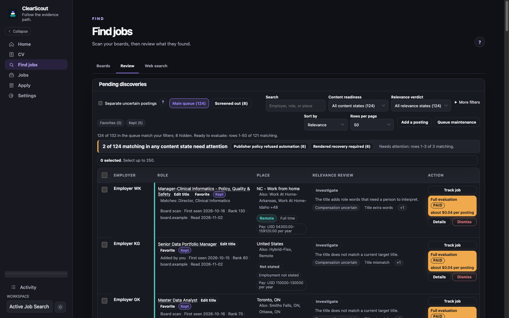
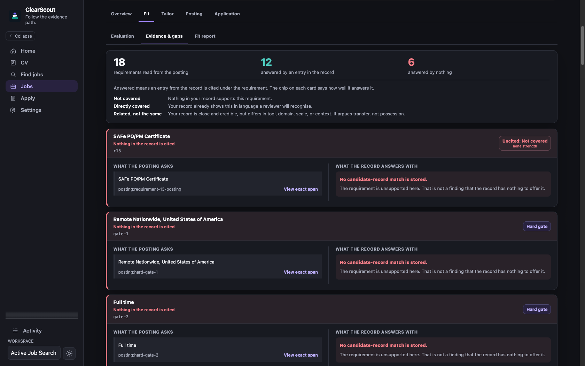
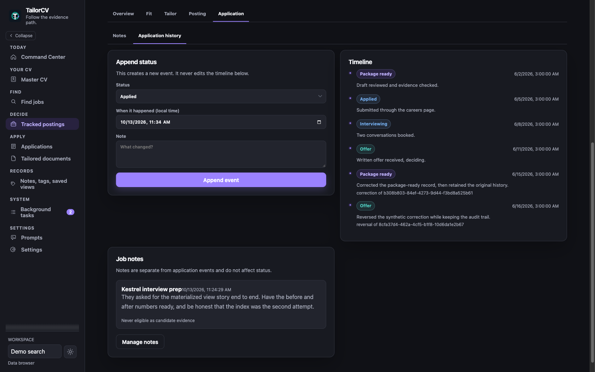

# Follow one requirement through ClearScout

On real postings, the question behind a draft is simple: what in the career
record supports this sentence? A score does not answer that, and neither does
polished wording.

This tour follows a job from lead to application history. You can also read
the [prompts](../prompts/README.md) without running anything. They show how the
model is asked to read, match, draft, and critique.

The discovery and evaluation screenshots come from a live workspace with
employer names redacted. The application timeline comes from the synthetic demo
workspace. Its person, employers, postings, dates, scores, costs, and documents
are invented, and seeding it makes no provider or job-board request.

## Start with a lead

A URL from search or a board scan enters Pending discoveries (Find jobs >
Review). ClearScout keeps how it was found, the publisher facts known before a
full read, and typed screening findings beside the lead. It does not call that
an evaluation. Unknown facts stay visible instead of becoming an inferred match.

A board listing whose title neither fits nor clearly misses your target roles
is kept, but it skips Pending discoveries and relevance review. Find it in
Screened candidates under the scan in Find jobs > Boards > History. Add to
pending and read moves it into the queue and reads the posting if publisher
policy allows. No listing is dropped just for missing the automatic rule.

Board and sitemap reads are bounded per task. When a supported source has more
pages or posting URLs than one task can read, ClearScout keeps the exact next
page or URLs as durable continuation work. It does not restart the source or
drop the unread tail. A sitemap read stopped by a discovery bound says so and
stays incomplete, so a partial read is never reported as the whole board.

The optional Search terms panel (Find jobs > Web search) suggests terms from
cited CV evidence. It does not fetch postings or review the queue. A free scan
reads the registered sources, and explicit evaluation compares selected
postings with the CV. Past relevance reviews stay visible with their recorded
inputs.

Each row shows how it was found (a board scan, or added by you), the date first
seen, and its rank. The relevance review marks these Investigate and names what
a person still has to check, such as uncertain compensation. The **Where it
came from** filter separates board-scan leads from postings added by URL.
Employer names and board addresses are replaced with labels.

## A high score cannot fill an evidence gap

The posting below scores 92 overall. That helps order the list, but it does not
know whether you want the job. Of 29 requirements read from the posting, 26 are
answered by a CV entry and 3 have no cited candidate-record evidence.

The posting asks for hands-on experience with a named tool and for occasional
travel. The selected CV evidence answers neither, so ClearScout shows the
posting text and states that no candidate-record match is stored. It does not
infer a preference or qualification from the rest of the score. A fit score
orders work under the saved policy. It is not permission to draft a missing
fact.

## Drafting can use only the selected record

A tailoring run selects master-CV entries within the document budget before a
model drafts. The response schema can cite only those identifiers. The program
copies titles, employers, dates, education, and publication citations.
Deterministic checks reject uncited lines and unsupported numbers.

The model can change the wording, and citation checks do not prove every
semantic claim. Review qualifications, ownership, and metrics against the
linked source. [Truth and provenance](truth-and-provenance.md) states the full
rule.

If the CV omits relevant experience, run `clearscout discover` in a terminal.
It asks about the gap and calls no model. It writes only complete answers you
confirmed, after showing the exact change to your master CV file, and logs what
it added. Import the updated file to create a new master-CV version. Earlier
versions and their evaluations stay unchanged.

A direct edit to the master CV saves free when the canonical parser accepts it.
When it does not, the CV page shows why after Review changes. You can fix the
draft or choose Re-read and save, a paid model call that first asks you to
confirm a cost estimate.

## Approval belongs to exact bytes

ClearScout stores each document proposal with its evidence identifiers and a
digest. A reviewer can accept, reject, or replace the wording. A replacement is
checked against the same evidence set, so review cannot turn an unsupported
source identifier into an approved one. A person still has to judge what the
replacement means.

If the proposal bytes change, the earlier approval no longer applies. Opening a
document or report approves nothing and calls no model.

## Later corrections do not erase the first record

Application status, notes, attachments, corrections, and reversals append to
the same local history. A correction points at the event it supersedes instead
of rewriting it.

The synthetic timeline keeps the original package-ready and offer events, the
correction, and the later reversal. The current state changes, and the earlier
record stays.

## What this tour establishes

The seeded workspace lets you inspect the screens and records without a live
service. You can follow a source, see an unanswered requirement, review a
draft, and read a correction alongside the earlier event.

It does not prove that a live model judges fit well, that a board still
answers, that a renderer makes a suitable PDF, or that a tailored resume
changes a hiring outcome. [Validation status](validation.md) explains those
limits.

To inspect the workspace yourself, follow [Try the synthetic
workspace](../README.md#try-the-synthetic-workspace). To use a real CV, install
a tagged release ([README](../README.md#install-a-tagged-release)) and continue
with the [user guide](user-guide.md).
