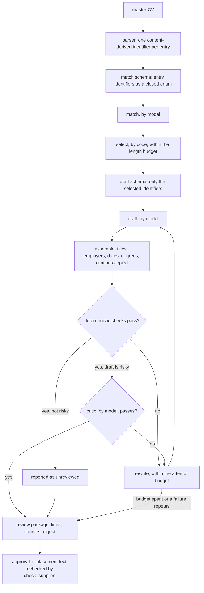

# Truth, evidence, abstention, and approval

One rule sits under all of this: a model may rephrase evidence you gave it, but
it may not expand the record. This page shows how that is enforced and where
human review is still needed.

## The vocabulary is closed

Every usable entry in your master CV gets an identifier derived from its
content. Response schemas are built at runtime over exactly those identifiers.
Matching may cite any that exist; drafting may cite only the ones selection
kept. The provider schema limits identifiers, and local validation also refuses
unknown ones before they become accepted evidence.

Every drafted line carries the identifiers it came from. Stored evidence keeps
the artifact hash plus the locator or character anchors that point back at the
original text. Titles, employers, dates, degrees, and publication citations are
copied from the parsed record, never written by a model.

_Traced, under `src/clearscout/`, from `_entry_id` in
`application/master_cv/cv.py`, `response_schema` in
`application/tailoring/stages/match.py`, `draft_schema` in
`application/tailoring/stages/draft.py`, the rewrite loop in
`application/tailoring/pipeline/rewrite.py`, and `check_supplied` in
`application/tailoring/stages/verify/resume.py`._

Deterministic checks then look for missing citations, numbers absent from the
cited evidence, required and forbidden wording, approval digests, and
structural problems. The model critic handles what code judges badly:
preservation, alignment, specificity, readability, and voice. It cannot make an
unsupported line acceptable. These checks are bounded, not proof of semantic
entailment. A cited sentence can still overstate ownership or drop a
qualifier, so factual review stays explicit even when the checks pass.

CV intake preserves the ordered words of cited professional prose. It refuses
reused lines and lines that cross the extracted role boundary. It may refuse an
unusual layout, but it never silently repairs an ambiguous ownership map.

## "Not stated" is an answer

A posting is read twice, and both readings are reported:

- The model pulls structured requirements from the posting text, which is
  bounded and treated as untrusted.
- Deterministic rules read the literal facts: location, arrangement, level,
  pay, eligibility language, and experience floors.

The rule reading abstains when the text and your configured vocabulary do not
settle something. For `place_fit`, `arrangement_fit`, `level_fit`, and
`pay_fit`, an unset preference or an unstated posting value gives `not stated`.
That is not a refusal, and it must never harden into a gate. A refusal is
something you stated. It is never inferred from silence.

Where the two readings disagree, you see both side by side. Neither overwrites
the other: one of them is wrong, and the program cannot tell which.

## History only grows

Evaluations, evidence, events, approvals, and version histories append, and
[the database refuses to change them](contributing/database-and-migrations.md#what-the-schema-guarantees).
Recalculating an evaluation must name the current version exactly and append
its unique successor, so a stale writer cannot branch or overwrite the chain.
Corrections point at the event they supersede instead of deleting it.

Archiving a job changes what you see and writes an audit event. It deletes
nothing: applications, artifacts, evaluations, and history all survive. Active
selectors hide them while the parent is archived, and unarchiving brings them
back.

## A reviewer cannot widen the evidence

Every proposal stores its text, evidence identifiers, payload, and a digest.
Your decision must name that exact digest, and it appends accept, reject, or
replace. Replacement text is checked against the same evidence and cannot reach
a source outside the record. Overriding something citation-backed needs a
reason, which becomes its own digest-bound decision.

Opening a report, a job, a history, or a stored document never approves
anything and never calls a model.

## A new claim comes from you

A new claim enters the master CV three ways: you edit it on the CV page, you
re-import a source, or you answer `clearscout discover` in a terminal. Edits
and imports append a new master-CV version.

Discovery asks about a gap and makes no model call. It records only complete,
explicitly confirmed answers, and refuses invented figures and anything that did
not come from you. It rewrites your master CV file after showing the exact
change and logs what it added; import that file to make a new version. Stored
versions and their evaluations never change. Refusing to add something is a
correct outcome, not a failure.

## Untrusted input

A CV and a job posting are data written by someone else, not instructions.
Prompts mark and wrap them as untrusted, and the prompt files are versioned
under `prompts/`. With the provenance checks, this reduces prompt-injection
risk. It is not a sandbox or a malware scanner.
