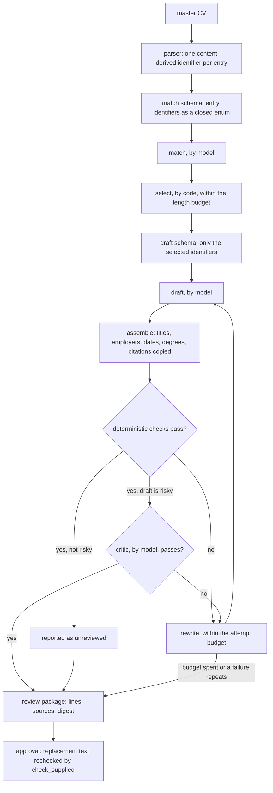

# Truth, evidence, abstention, and approval

One rule sits under all of this: a model may rephrase evidence you already gave
it, and it may not expand the record. Everything below is how that is enforced
and where human review remains necessary.

## The vocabulary is closed

Every usable entry in your master CV gets an identifier derived from its own
content. The response schemas are then built at runtime over exactly those
identifiers: matching may cite ones that exist, drafting may cite only the ones
selection kept. The provider schema limits identifiers; local validation also refuses unknown
identifiers before they can become accepted evidence.

Every drafted line carries the identifiers it came from, and stored evidence
keeps the artifact hash plus the locator or character anchors needed to point
back at the original text. Titles, employers, dates, degrees, and publication
citations are copied out of the parsed record, never written by a model.

_Traced, under `src/clearscout/`, from `_entry_id` in
`application/master_cv/cv.py`, `response_schema` in
`application/tailoring/stages/match.py`, `draft_schema` in
`application/tailoring/stages/draft.py`, the rewrite loop in
`application/tailoring/pipeline/rewrite.py`, and `check_supplied` in
`application/tailoring/stages/verify/resume.py`._

After that, deterministic checks look for missing citations, numbers that are not
in the cited evidence, required and forbidden wording, approval digests, and
structural problems. The model critic handles the things code judges badly:
preservation, alignment, specificity, readability, and voice. It cannot make an
unsupported line acceptable. These are bounded checks, not proof of semantic
entailment. A cited sentence can still overstate ownership or omit a qualifier,
so factual review remains explicit even when structural checks pass.

CV intake preserves the ordered words of cited professional prose and refuses
reused lines or lines crossing the extracted role boundary. It may refuse an
unusual source layout; it does not silently repair an ambiguous ownership map.

## "Not stated" is an answer

A posting gets read twice, and both readings are reported:

- The model pulls structured requirements out of the posting text, which is
  bounded and treated as untrusted.
- Deterministic rules read the literal facts: location, arrangement, level, pay,
  eligibility language, experience floors.

The rule reading abstains when the text and your configured vocabulary do not
settle something. For `place_fit`, `arrangement_fit`, `level_fit`, and `pay_fit`,
either an unset preference of yours or an unstated value in the posting gives
`not stated`. That is not a refusal, and it must never harden into a gate. A
refusal is something you stated, and it is never inferred from silence.

Where the two readings disagree, you get both, side by side. Neither one
overwrites the other, because one of them is wrong and the program cannot tell
which.

## History only grows

Evaluations, evidence, events, approvals, and version histories append, and
[the database refuses to change them](contributing/database-and-migrations.md#what-the-schema-guarantees).
Recalculating an evaluation
has to name the current version exactly and append its unique successor, so a
stale writer cannot branch the chain or paint over it. Corrections point at the
event they supersede instead of deleting it.

Archiving a job changes what you see and writes an audit event. It deletes
nothing: applications, artifacts, evaluations, and history all survive. Active selectors just stop showing them while the parent is
archived, and unarchiving brings them back.

## A reviewer cannot widen the evidence

Every proposal stores its text, its evidence identifiers, its payload, and a
digest. Your decision has to name that exact digest, and it appends accept,
reject, or replace. Replacement text is checked against the same evidence and
cannot reach for a source outside the record. If you override something that was
citation-backed, you have to give a reason, and that becomes its own digest-bound
decision.

Opening a report, a job, a history, or a stored document never approves anything
and never calls a model.

## A new claim comes from you

A new claim enters the master CV three ways: you edit it on the CV page, you
re-import a source, or you answer `clearscout discover` in a terminal. Edits and
imports append a new master-CV version.

Discovery asks you about a gap, and it makes no model call at all. It records
only complete, explicitly confirmed answers and refuses invented figures and
anything that came from somewhere other than you. It rewrites your master CV
file after showing you the exact change and logs what it added; import that
file to make it a new version. Stored versions and the evaluations tied to them
are never changed. Refusing to add something is a correct outcome, not a failure.

## Untrusted input

A CV and a job posting are data written by somebody else, not instructions.
Prompts mark them and wrap them as untrusted, and the prompt files stay versioned
under `prompts/`. Together with the provenance checks this reduces the risk of
prompt injection. It is not a sandbox and it is not a malware scanner, so do not
read it as one.
