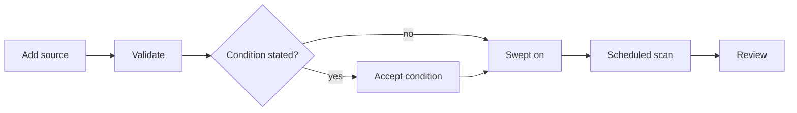

# Use ClearScout locally

Start small. Create one workspace and add a posting you want to consider.
Discovery and manual tracking need no CV or provider key.

For model assistance, import a master CV, evaluate one posting, and read the
cited evidence and unanswered requirements before asking for a draft. Approve
only a document proposal you have read. Checking what it says takes attention.
ClearScout records that work. It does not submit anything.

The [synthetic product tour](product-tour.md) shows the complete evidence path
without requiring an installation. Exact flags and less common commands belong
to `clearscout --help` and `clearscout <command> --help`.

## Install the release before using real data

Version 0.1.0 is the first public alpha, published as a pre-release on
[GitHub Releases](https://github.com/sethstraw/clearscout/releases). Verify and
install its release wheel as described in the
[README](../README.md#install-a-tagged-release). The contributor setup in
[CONTRIBUTING.md](../.github/CONTRIBUTING.md) is for changing ClearScout; do not treat a
development checkout as a release artifact. ClearScout is not published to PyPI and
a direct Git install does not contain the production web client.

## Initialize one workspace

There are two alternative ways to create a workspace; choose one. The free path
runs `clearscout db upgrade` and `clearscout start`, then creates the workspace
in the browser. The CV path runs `clearscout init --cv ...`, which creates the
database, a workspace, and the master CV in one step; then run
`clearscout start`. Each `clearscout init` run creates a new workspace, so do
not run it after creating one in the browser unless you want a second one.

For free discovery, initialize the database and start the local application:

```bash
clearscout db upgrade
clearscout start
```

Open the printed URL. Create a workspace without a provider key or CV.
Search setup can be skipped and reopened from Welcome or Settings.
Add an individual posting link while you decide which roles to search for.

Evaluation and drafting need a master CV and configured provider access.
[Validation status](validation.md#provider-claims-are-deliberately-uneven)
says which provider has run live, and
[CV ingestion](validation.md#cv-ingestion-remains-a-limitation) is not yet well
tested across real-world layouts and formats.

The evidence source is a master CV in ClearScout's standardized Markdown format,
not an arbitrary uploaded resume. Its structure determines what the parser
makes available for downstream evaluation, selection, and drafting. Use
`clearscout template` as the starting format. An accepted file type or a completed
import is not proof that all your evidence is available to those stages.

Choose a private location for the source CV. Word, PDF, Markdown, plain text,
and images are accepted. An OpenAI or Anthropic API account is separate from
any chat subscription. Ordinary file intake uses that account and can cost
money. Initialization asks for provider access when it needs it. Invoking it
with an ordinary CV starts paid restructuring without a separate cost
confirmation. Keep the key out of commands you share.

```bash
clearscout init --cv ./Existing_CV.docx --name "My Job Search" --slug my-search
```

It prints the paths of the settings file, the master CV, and the database, and
how the CV was imported.

A canonical ClearScout Markdown CV is adopted without a model call. Other formats
are extracted, sent to the configured provider for restructuring, then checked
for provenance and lost content. Read both the resulting master CV and the
import report. A successful import does not prove that a model assigned every
line correctly. A section the parser does not recognize, such as `## Projects`,
stays in the master CV. Its lines are never cited or printed. Put project work
under the role it belongs to.

`clearscout init --help` shows the data-root, workspace-root, provider, and
configuration overrides. Keep the database and its artifact root together
unless you have a deliberate storage boundary; backup and relocation depend on
both. [Storage and portability](storage-and-portability.md) explains those
procedures.

## Choose the free or paid path

"Free" here means no model-provider charge. A board read still contacts an
external website. Internet access and the site's reading policy still apply.
Local-first describes storage, not a promise that your CV never leaves the
machine. Paid stages send their selected input to your configured provider.


| Task                                                       | Provider charge | What to expect                                                |
| ---------------------------------------------------------- | --------------- | ------------------------------------------------------------- |
| Open the synthetic demo                                    | None            | Invented records, without any external request                |
| Adopt a canonical Markdown or text CV                      | None            | Existing ClearScout structure is retained                     |
| Import Word, PDF, images, or non-canonical text            | Paid            | STRUCTURE and INGEST calls, then an import report             |
| Save a master CV edit the canonical parser accepts         | None            | A new version with your text                                  |
| Save a master CV edit the canonical parser rejects         | Paid            | A STRUCTURE call with no dialog; fails with no key set        |
| Edit search settings or register a source                  | None            | Local settings; validation may read the source website        |
| Preview, revalidate, schedule, scan, or continue a source  | None            | External reads under the source policy                        |
| Add posting URLs, refresh postings, or rescreen the queue  | None            | Deterministic reads and screening                             |
| Retry a guided campaign's board reads                      | None            | Local reads of addresses already found                        |
| Track a found job and record your priority, fit, and note  | None            | Saved discovery and your own judgment                         |
| Read reports, edit notes, or record events on tracked jobs | None            | Existing local records and history                            |
| Edit prompts, rule on requirements, view spend, preflight  | None            | Local records and estimates                                   |
| Refresh the price table                                    | None            | A web read of published prices                                |
| Verify an artifact or render a document                    | None            | Local checks, or your external render command                 |
| Upload files actually submitted with an application        | None            | Exact local bytes, labeled separately from drafts             |
| Suggest search vocabulary                                  | Paid            | CV-grounded search terms; no web search                       |
| Find new jobs with a guided campaign                       | Paid            | OpenAI hosted search, then local reads                        |
| Review relevance on selected postings                      | Paid            | RELEVANCE_REVIEW, up to 20 postings per call                  |
| Evaluate a posting                                         | Paid            | JOBSPEC and MATCH; free when a rule refuses first             |
| Recover posting content with model assistance              | Paid            | POSTING_RECOVERY and up to two hosted searches                |
| Re-check disputed requirements                             | Paid            | One JOBSPEC or MATCH call; see the section below              |
| Compare postings in a batch                                | Paid            | JOBSPEC and MATCH per posting                                 |
| Tailor a resume and cover letter                           | Paid            | JOBSPEC, MATCH, DRAFT up to 3 tries, COVER, CRITIC            |
| Build an approved derivative                               | Paid            | The tailoring stages; an exact reused package is free         |
| Retry a failed paid task                                   | Paid            | The same stages again                                         |
| Record review decisions or download stored Markdown        | None            | An existing draft; this does not build an approved derivative |

The CLI follows the same line. `clearscout discover`, `template`, `doctor`,
`report`, `search show`, `db`, `auth`, `start`, `stop`, `status`, `serve`, and
`worker` are free. `clearscout run`, `screen`, `batch`, `import`, and
`tasks tailor` call models and are paid. `clearscout init --cv` is free for a
canonical Markdown or text CV and paid for any other format. Background tasks run on the OpenAI flex tier and the Anthropic
standard tier. The CLI and master CV import run on the standard tier.

A paid task with no key set is accepted into the queue and fails when it runs.
Evaluation and `clearscout run` need a key even when the response cache would
answer.

Nothing the program schedules by itself is paid. Scheduled scans, catch-up
scans, and screening are free. Every paid task starts with a person.

[Re-check disputed requirements](#re-check-disputed-requirements) covers the
paid re-check buttons.

To explore seeded records without a provider account, use the synthetic workspace in the
[README](../README.md#try-the-synthetic-workspace). Read the seeded evaluations
and documents. The seed does not make paid actions free: approving a new model
task still needs a configured provider and can incur charges.

For a real search without model charges, create a workspace in the browser.
Use manual search setup to state your target titles and preferences. Save at least
one manually entered target title before scanning an employer board. Individual
posting-link intake is available without target titles, a CV, or a provider key.
Register a board when you want repeated scans of its openings; paste a posting
link when you want to inspect one particular role. Recognition does not guarantee
a permitted or complete read. Check the source's actual coverage and recovery
action, and use individual-link or published-text intake where allowed.

A CV is optional for discovery. For later evaluation, start with a canonical CV. `clearscout template` writes the skeleton to `CV_Master.md` in the current
directory; pass a path to write it elsewhere. Fill it with your own evidence
before importing it. Register boards, scan, and inspect listings. On a pending
row, select **Track job**. It is free, adds the job to **Jobs** without a model
evaluation, and opens the job's page.
The job will show **Not evaluated** and no model score. In the job overview,
you can record your own priority, fit, and note to compare it with other jobs.
On the Application history tab, record the status and the date it happened.
The resulting application has a Files page where you can upload the exact
submitted resume or cover letter. Choose a submitted role only for files you
actually sent; related drafts appear separately. Full evaluation and new
model drafts remain optional paid actions.

Choose paid work by the result you need:

- Search vocabulary suggests CV-grounded terms without fetching postings or
  boards. Use it when you want help naming the search.
- A guided campaign searches beyond saved boards. Use it when your registered
  sources do not cover the search.
- Relevance review compares an explicit selection of readable discoveries with
  your CV and preferences. It helps choose which postings deserve closer review.
- Evaluation links a posting's requirements to CV evidence and reports fit.
  Read that evidence before deciding to draft.
- Tailoring produces a resume and cover letter from selected evidence, then
  checks the drafts. Read every line before approving a document.

Vocabulary, guided campaigns, and relevance review need a saved search-parameter
version and an imported master CV. Evaluation and tailoring also need a master
CV. All need configured provider access and the local worker. Ordinary model
stages use the configured OpenAI or Anthropic adapter; guided campaigns require
OpenAI background web search.

For the first paid result, use one posting. Read the selected scope and
[available cost information](#check-cost-before-approving-work) before
confirming. Estimates advise; they do not set a spending ceiling. The Model
spend report records calls that ran, their usage, and their costs; missing
prices remain unknown. Selecting a previously reviewed row again can incur
another charge.

## Start ClearScout

Start the local application and its one durable worker:

```bash
clearscout start
```

It binds the API to loopback, starts the worker against the same resolved data
root, waits for local health, and prints the URL to open. Use `clearscout status`
to check both processes and `clearscout stop` to stop only the processes started
by this command. `stop` allows up to 60 seconds for active worker tasks to finish,
with the API still available. A worker still busy after that with only source
scans or artifact checks is killed. The interrupted task resumes on the next
`start` once its lease expires, about a minute later. A worker running any other
task, such as a paid model call, is left running and `stop` names that task;
retry after it settles. It then stops the API and waits up to 60 seconds for it
to exit. Open requests get 30 seconds to finish. A timeout preserves process
ownership and names the process still stopping. Queued tasks remain queued.
The next `start` reconciles staged artifacts before launching either process.
`start` does not run migrations; if the schema is behind, run
the explicit database command the error names first. Server and worker output is
appended to `clearscout-serve.log` and `clearscout-worker.log` in the ignored
`.clearscout-runtime` directory under the data root.

For development or separate process supervision, you can still run the two
services individually:

```bash
clearscout serve
clearscout worker
```

The worker leases queued work from the same database. Use the same
`--data-root` for both commands if you override the default. One worker per
database is supported, and a second one is refused. A task that remains queued
usually means the worker is absent; the **Activity** page records the durable state and
any bounded error.

Inside that one worker, board continuations for boards on different hosts read
at the same time, four at once by default. Two continuations for boards on the
same host still take turns. Set `CLEARSCOUT_CONTINUATION_SLOTS` (1 to 8) before
`clearscout start`, or pass `--continuation-slots` to
`clearscout worker`, to change that number. Ctrl-C on `clearscout worker` lets the
running continuations finish first; a second Ctrl-C stops without waiting.

## Finish the setup walkthrough

The browser opens the setup walkthrough on its own only when no workspace exists.
If you ran `clearscout init`, you already have one, and the application opens
directly. Free setup has three steps, and it starts at the first one not yet
done:

1. Workspace: create a local search record.
2. Search setup: enter preferences, review them, and confirm one saved version.
   You can skip this step and reopen it from Welcome or Settings.
3. Posting links: add individual postings to inspect.

Manual search setup walks through Role preferences, Places and residence,
Working arrangements, Optional pay preferences, and a final review. In each
basic section, enter the values you mean or choose **No restriction in this
section**. Blank fields remain unstated. The review shows any retained advanced
preferences as well.

Finishing the walkthrough requires at least one target title. **No restriction**
in Role preferences clears its limits and exclusions while keeping target
titles. You can skip the walkthrough and use individual posting links instead.

These answers remain a draft until **Confirm and save preferences** saves the
whole version. Residence and work authorization are separate answers: living in
a place does not establish permission to work there. Board scans require at
least one manually saved target title. Individual posting links remain usable
without target titles, a CV, or a provider key.

Provider access and CV import are optional links to **Settings > Provider** and
the **CV** page. No provider call is needed to create a workspace.

The server never returns a provider key to the browser. The browser can send a
new key once to the local API; later reads return only whether one is present,
and the server keeps the value in the operating-system keyring.

Settings owns search parameters, provider access, drafting guardrails, and
costs. Its tabs are **Search**, **Provider**, **Drafting**, **Costs**,
**Notes & tags**, and **Advanced**; Advanced holds **Prompts**,
**Diagnostics**, and **Posting refusals**. Boards and their reading conditions
are managed under **Find jobs > Boards**. **Settings > Costs** holds the Model
spend report, which shows recorded calls and costs. A missing price is not a zero price, so totals
are withheld when any included call cannot be priced.


The report preserves call-level usage as well as totals, so an operator can
compare the local ledger with the provider account.

## Add one posting before widening the search

Open **Find jobs > Review > Add a posting**. Paste one direct public
posting URL, or several with one link per line. The optional title and
**Check posting** apply to one link at a time.

Each added link gets a free content read under the source policy. The publisher
check made while adding, and the first content read after it, read the link you
entered even where robots.txt disallows crawling. They stop only when robots.txt
names ClearScout. Every later refresh honors a robots disallow. Results name
added, duplicate, invalid or unsupported, and failed links separately. Invalid
and failed links stay editable for correction or retry. A saved link whose read
could not be queued stays saved; use its free refresh action to retry the read.
Adding a link does not evaluate it or call a model.

### How to choose a link

Sources are for repeated scans. Individual posting links add one opening.
Choose the page by what it describes, not by its hostname.

An applicant tracking system (ATS) is the hiring software an employer uses to
list openings and collect applications. You do not need to identify the vendor.
A board can live on the employer's domain or the software provider's domain.

| Example                                                                   | Page purpose and where to use it                                                                                                        |
| ------------------------------------------------------------------------- | --------------------------------------------------------------------------------------------------------------------------------------- |
| `https://www.example.com/careers/`                                        | An employer careers landing page. It introduces working there and links to openings. It is not one job. Follow its open-positions link. |
| `https://ats.example.net/example-co`                                      | A job board listing several openings, hosted by the employer's hiring software. Add this as a source.                                   |
| `https://ats.example.net/example-co/jobs/4815162342`                      | One posting that describes a single role. Paste it into posting-link intake.                                                            |
| [ClearScout software repository](https://github.com/sethstraw/clearscout) | Holds this project's code. Its repository URL is not a job posting.                                                                     |

These addresses show the shapes only; they do not lead to real openings. A role
can expire. If a posting closes, choose another individual opening from its
board.

A search-results URL is a list, not one posting. A sign-in form alone is not a
readable job description. Direct application links can work when a supported
reader can recover the published posting. Prefer the description page when one
is available. Tracking and short links may redirect to a different page.

A company homepage or repository issue is not an opening merely because its
address contains jobs or careers. A publisher page on GitHub can be an individual
posting if it actually describes one role.

Recognition does not establish complete coverage or permission to read every
endpoint. Check the source's actual read result and coverage explanation. When
a board cannot be read, add an individual posting link or its published text
where intake permits it. Published reading policy still applies.

Find jobs has three tabs:

- **Boards** scans all enabled sources, an explicit source selection, or one
  source. Selected scans can include sources excluded from bulk scans;
  selecting them does not enable them. It manages your sources under
  **Your boards**, sets an optional **Scan schedule** with a saved scope, and
  keeps a **History** section with board scan history and screened-out
  listings and titles. Read history is filterable by source and result. It
  shows retained dated source and query records; same-day rescans can replace
  a record.
- **Review** is the pending queue. Add an individual posting link, inspect its
  retained content, and track or dismiss it for free. Optional relevance review
  is a separate paid action on an explicit selection. Choose **Screened out**
  in the queue filter to see postings that conflict with your rules.
- **Web search** runs a guided campaign that searches the web for new postings
  and employer boards. It also offers a separate search-vocabulary action. That
  action proposes search terms from cited CV evidence and fetches nothing. Each
  is its own paid task with its own approval and cost.

**Settings > Advanced > Posting refusals** keeps the refusal history.

A model may propose a source or lead. It does not override URL, robots,
redirect, rate, or published-condition policy. A board scan sends no CV text or
search parameters. Scheduling is optional and calls no model.

Version 0.1.0 has known fit, search, board, cost, progress, and tailoring
limits, listed in [validation status](validation.md#known-limits-in-010). Treat
a recommendation as a starting point and read every drafted line before you
use it.

Select only postings worth evaluating. Evaluation is queued, may call the
provider, and commits the posting, requirements, evidence links, factors, and
verdict together. Open that result before configuring a broader search. A
refusal is not a low score: it means ClearScout could not make the claim under the
applicable rule.


Each row also carries Favorite and Keep controls.


Each row in **Review** keeps the source, published summary facts, and
screening findings beside the posting, so a row can be judged without opening its
details. A finding can match, refuse, or remain unknown;
missing or incomplete board facts stay unknown rather than being treated as a
match. Employer, title, and location proposed by hosted search are labeled as
unverified hints and cannot produce deterministic screening findings until a
local read supplies publisher facts. The queue recommendation is an ordering
aid, not a fit evaluation.

Select up to 250 eligible discoveries across pages. **Select eligible discoveries
on this page** selects the loaded page, not the whole filtered queue. The action
confirmation includes selections from other pages. **Track selected** is free
and reports each job's result; failures stay selected for retry. Relevance
review and evaluation are separate paid actions on that selection.

Use **Favorite** for your best matches and **Keep** when the program misjudged
a row. Favorites sort first, then kept rows. Either marker protects the posting
family from bulk and program dismissals. A confirmed dismissal from the row's
own control clears its markers. A one-line keep note gives the relevance
reviewer your reason; it does not change the posting's evidence.

A posting you add from its link is not dismissed by a screening or evaluation
refusal. Evaluation still refuses it before any provider call, and the row
stays in the queue, where a relevance review may still read it. It is
dismissed when its body lists no requirements, and it leaves the queue when it
closes or its evaluation creates a job. It stays yours when a tracked board
later lists the same posting, and that board's complete read marks it withdrawn
once the board stops listing it. Adding the link of a posting a board already
staged does not make it yours.

An aggregator read, such as Himalayas or Arbeitnow, takes only a fixed number
of the site's newest listings, so it is never complete and a job missing from
it is never marked withdrawn. Himalayas states when each job stops being listed, so every
read of a Himalayas source withdraws a staged row once that time passes, and a
listing already past it is never staged. If Himalayas still serves the job
after that time, the row stays withdrawn; a later read that moves the stated
time forward reopens it. The stated time belongs to Himalayas, so a row another
source lists afterwards drops it. A job a board closes earlier than it
stated, or an aggregator row with no stated expiry, stays in the queue until
you dismiss it, or until **Refresh posting** reads the posting as closed.

The Dismissed panel offers **Restore and keep**. A marked posting that closes
at its source remains visible as no longer listed, but does not count as ready
for review.

Board scans and guided-campaign board reads retain listings refused by
deterministic search conditions so the refusal remains actionable. The pending
queue includes uncertain postings by default under **Not excluded**. Choose
**Screened out** to see postings that conflict with your rules, and postings
whose title the employer marks "do not apply" or "test requisition". Readable
refusals need your decision, not a content refresh. Their bodies remain
available, and only you decide whether to track or dismiss them.

Enable **Separate uncertain postings** to show only the pursue route in the
main queue. **Unconfirmed matches** groups investigate, needs-verification, and
uncertain-pay routes. With that option off, these postings appear in
**Main queue**; inspect the subset through **More filters > Constraint route > Unconfirmed matches**.
Its counts include all content states unless you choose a
Content readiness filter. The strict choice is saved per workspace in this
browser; it changes visibility, not search parameters or screening rules.
Adding a posting temporarily reveals all constraint routes so its result stays
visible. The page explains this; choose **Main queue** to return to strict view.

A posting whose retained text reads as cut off shows **Needs recovery** (Only
part of the posting was read). Short text that ends mid-sentence, or text the
latest relevance review found too short to judge, is read this way, and a full
evaluation skips it at no cost. Attach the full posting text or find the
employer's page first. Text you attach yourself is never read as cut off.

Unconfirmed facts do not require a paid evaluation. Track saves a job for free.
Full evaluation is optional and compares the posting with your CV.

Pay extracted from posting text remains visible but does not automatically
confirm or refuse your pay preference. Check the quoted range yourself. A
labelled range under 200 with no period word, such as "Pay range: $45 - $61",
reads as an hourly rate. When a posting lists a Primary Location range beside
other locations' ranges in the same country, the Primary Location range is read.
Refreshing unchanged text does not clear that uncertainty. No extracted pay
means none was confirmed in the saved evidence.

Filters apply to the whole queue before paging. Each filter's choice counts retain the other filters,
each lane states its matching range and total, and the newer-rows banner uses
the same filters. Under **Find jobs > Boards > History**, the collapsed
**Screened out in latest scans** table counts each source's screened-out
listings from its latest board scan, with a link to review them.

The relevance filter uses plain-language states such as High relevance, Needs
closer look, Low relevance, and Not yet reviewed, and those states order the
pending queue. Full evaluation uses separate application
decisions such as `apply_now` and `deprioritize`; those words are reserved for
the evidence-backed fit report.

Relevance review is a separate paid task from search vocabulary and from a
guided campaign; it takes an explicit selection of pending discoveries,
regardless of how they entered the queue. Review relevance pays to review every
readable row in the selection, including ones already reviewed under the current
parameters, and spends nothing on an unreadable row. Historical relevance reviews
retain their core-work and qualification judgments, condition status, posting
citations, CV citations, and unresolved questions. Use an explicit evaluation
when a selected posting needs a fresh assessment.

Stated unwanted work can produce an `unlikely` relevance verdict when the
reviewer reads it as the posting's defining work. That reading is the model's
and no program check confirms it; an incidental mention is not meant to count.
The review retains the posting citations behind that reading.

A guided campaign and a board scan each also report a funnel audit. It names
the candidates proposed, the boards read, and the candidates that reached
screening and staging. Each refusal or omission carries a typed reason. A
staged direct link does not count as fetched or read. Detailed outcomes are
bounded for display while the complete counts and omitted count remain
visible. A search-vocabulary run proposes no postings or boards, so its funnel
audit is always empty.

## Add boards and scan them on a schedule

Every step here is free. It reads boards under their published policy and
calls no model.

1. Save at least one target title under **Settings > Search** (Target titles).
2. Open **Find jobs > Boards**. Under **Your boards > Add a board**, paste the
   **Board or careers address**. A posting link from the board also works as a
   starting point; [How to choose a link](#how-to-choose-a-link) shows the
   shapes.
3. Choose **Validate** to preview what ClearScout can read there.
4. Enter the employer name. To record a published reading condition, open
   **Advanced: reading condition** and fill **Condition on reading it**. Then
   choose **Add source**.
5. Switch on **Swept**. A source that states a condition shows it first and
   waits for you to accept it.
6. Open **Find jobs > Boards**. Under **Scan schedule**, open
   **Set up a scan schedule**. Choose daily
   or weekly, a local time, and a named time zone such as `Europe/London`.
7. Keep the local worker running. Scheduled scans run only while it runs.
   After a shutdown, one catch-up scan runs on the next start.
8. Review new postings under **Find jobs > Review**.



The sections below give each step in full.

## Schedule free board scans

Open **Find jobs > Boards** and find **Scan schedule**. Each workspace
has one optional daily or weekly schedule. Choose a local time and named IANA
time zone, such as `Europe/London`; weekly schedules also need a weekday.
Save manually entered target titles before enabling a schedule.

Choose **All enabled sources at each run** for a scope that follows your source
settings. For a fixed subset, select sources in the manual scan table, choose
**Saved source selection**, then **Use current source selection** and save.
That selection can include sources excluded from bulk scans. Changing the
manual selection later does not change the saved schedule. Unavailable saved
sources stay listed and are skipped until available or until you replace them.

The schedule runs only while your local worker is running. Enabling or resuming
starts at the next future occurrence. After a shutdown, an overdue schedule
queues one catch-up scan, then returns to the calendar. It does not queue every
missed run. A repeated local time runs at its first occurrence; a time skipped
by a clock change shifts forward by the size of the gap.

**Pause schedule** stops future scheduled scans. Active scans continue; cancel
them separately in **Activity**. Resuming does not catch up occurrences missed while
paused. Check the saved calendar, next occurrence, and last task or error before
leaving the page.

## Add a board manually

Open **Find jobs > Boards**. A source is a board or careers page, not one
job's application form.


1. Under **Your boards > Add a board**, paste its **Board or careers address**.
2. Choose **Employer board** for one employer, or **Aggregator** for a site
   listing several employers.
3. Choose **Validate**. ClearScout checks the address and reports what it can
   read. Changing the address or kind requires validation again.
4. Enter a name under **Step 2: Name the board**. To record a published
   reading condition, open **Advanced: reading condition** and fill
   **Condition on reading it** and **Published at**. Leave these blank if you have not checked; blank does
   not mean permission was established.
5. Choose **Add source**. Check its **Swept** control. If the source states a
   condition, read and confirm it before enabling the scan.
6. Open **Find jobs > Boards**. Scan all enabled sources, select a
   subset and choose **Scan selected sources**, or use one source's Scan
   control. Check the confirmed scope, result, and read history. New candidates
   appear under **Review**.

Source setup and scanning call no model. Check both recognized platform and
observed coverage: recognition alone does not promise a readable or complete
board. A failed, refused, or incomplete read does not mean zero openings.
Repeated scans do not establish permission to read a source.

Read history is not a lifetime tally of every board read. Same-day rescans can
replace retained records. A continuation reports its own read counts; an
unknown final total stays unknown while the board read is incomplete.

For retained postings, **Refresh posting** reads without a model.
**Attach posting text** lets you supply text you obtained from the current
posting and confirm it belongs to that link. These free actions remain subject
to reading policy. **Estimate assisted recovery** previews a separate paid
operation; **Run assisted recovery** requires explicit confirmation. Its outcome
does not guarantee that a complete posting can be recovered.


## Add boards through guided search

Guided search finds new addresses. It is useful when the registered boards do
not cover your search, and it requires the OpenAI adapter's background-response
support.

1. Save your search parameters under **Settings > Search**.
2. Open **Find jobs > Web search** and inspect the campaign preview.
3. Read its planned scope and cost information. Confirm only the campaign you
   intend to run. Search-vocabulary suggestions are a separate paid action.
4. Follow the durable task under **Activity**. Its report separates
   proposed addresses, local reads, admitted candidates, and refusals.
5. Review candidates under **Find jobs > Review**. A search hint is not a
   verified publisher fact or a full evaluation.
6. Open **Find jobs > Boards**. Read the newly registered boards under
   **Your boards**, and
   any published conditions. Campaign-discovered boards begin disabled.
   Switch on **Swept** for those you want future free scans to read.

The campaign's board read and a later scan are separate operations. A board is
registered only when at least one of its listings reaches the queue. A board
that lists nothing, or whose listings all screen out, is reported as unresolved
and is not registered. Guided search does not enable every discovered employer
automatically.

## Read the evidence, not only the score

The **Jobs** page shows the stored verdict and its factors. Open one posting to
inspect the requirement text, source span, CV evidence, unresolved questions,
and the policy version that produced the result.

Use **Search jobs** to find an employer, role, location, scope, or rationale.
Search ignores letter case and treats wildcard characters literally. The
employer filter accepts several employers at once; its counts ignore that
selection while retaining the other filters.

Scores order work under the saved policy; they do not measure employability or
predict an interview. Each requirement is either answered by a cited record
entry or cited by nothing. A chip rates the match: "Directly covered",
"Covered, worded differently", "Related, not the same", "A fact you state", or
"Not covered". An
uncited requirement is unsupported, which is not a finding that the record has
nothing to offer it.

The full evidence rules, including abstention and supersession, are in [Truth
and provenance](truth-and-provenance.md).


The evidence view shows the important distinction: a requirement with no cited
record entry remains unsupported even when another part of the evaluation is
strong. The employer name in this image is replaced with a label.

Users rule on individual requirements as met, not applicable, or disputed. A
dispute says either that the CV does answer the requirement (a fit dispute) or
that the requirement was read wrongly from the posting (an extraction dispute).
A fifth value, reversed, is set only by the paid re-check described below and
always appears in the audit trail with the machine's cited quote.

## Re-check disputed requirements

The job page shows a free Refresh posting button unless the job is archived. It
re-fetches the posting body without calling a model. When a workspace has
enabled dispute re-extraction and the posting has an active extraction dispute,
a paid Refresh with dispute re-extraction button appears beside it. When fit
re-match is enabled and the posting has an active fit dispute, a separate paid
Refresh with fit re-match button appears. Neither appears on an archived job.
Turn on the opt-ins under **Settings > Advanced > Diagnostics**, in the
Learning-loop signals panel's **Re-check disputed requirements** section:
**Enable dispute re-extraction** and **Enable fit re-match**, then
**Save dispute settings**. Both are off by default.

Each paid action opens the standard spend-confirmation dialog. Re-extraction
runs one extraction call against the newly fetched body and reverses only when
the cited quote is present under the normalized-substring check. Fit re-match
runs one match call against the current master CV. It reverses only when it
cites a durable CV entry key that the prior match for that requirement did not.
Otherwise the ruling keeps its dispute kind and no reversal event is written.
Every reversal writes an audit event. The free Refresh never spends money.

## Tailor only from selected evidence

From a tracked posting, start a tailoring run when the evidence and guardrails
look right. The pipeline selects CV entries within the document budget, drafts
against those identifiers, verifies the result, and records every stage.

The proposal can contain only claims supported by the selected entries. Fixed
facts such as titles, employers, dates, education, and publication citations
are copied by the program rather than rewritten by a model. If the posting asks
for something the CV does not establish, use the discovery prompt to amend the
master CV first or leave the gap visible. The discovery prompt calls no model.

Saving an edit to the master CV depends on the text. An edit the canonical
parser accepts appends a new version with your text and calls no model. An
edit it rejects, such as one with no dated role or with list markers run
together, goes through ordinary import. That makes a paid STRUCTURE call with
no cost dialog. With no key set, the save fails validation instead.

## Walk through a synthetic application

Open the seeded workspace from the README. This walkthrough reads existing
records and requires no provider account.

1. Open **Jobs** and the Kestrel Freight Systems posting. Its
   overall score is 88, but the evidence view retains unsupported requirements.
2. Read a requirement beside its CV evidence. For an unsupported requirement,
   check the posting text rather than treating the score as an answer.
3. Open **Apply > Documents**, choose **Open job files**, and inspect the
   stored resume draft on the job's **Tailor > Files** tab.
   Follow its cited CV identifiers. Check qualifications, ownership, and numbers
   against the source. Citation checks cannot judge every meaning.
4. On the same Files view, open the draft and read its **Approval review**
   section for the recorded line-review decisions.
   The demo retains the original
   draft as well as accept, replace, and reject decisions. Downloading that
   draft does not apply those decisions or make it an approved final resume.
5. Open **Apply > Applications** and inspect the retained corrections and reversals.
   A status change appends history instead of erasing the earlier event.

The demo contains prewritten results. It shows review and record keeping, not
a live model's quality or a completed approved-document build. On a real
posting, evaluation and tailoring are paid tasks. The
[product tour](product-tour.md) follows the same evidence chain.
The [hybrid journey test](../tests/durability/test_workflow_hybrid_journey.py)
is contributor evidence for the offline path.

Costs are estimates and never stop an approved task. A retry may incur more
charges; review retained results before deciding to repeat the work.

## Approval names exact bytes

Review the Markdown proposal and its evidence before approval. You may edit the
wording, but the same evidence checks run again and a reviewer cannot widen the
selected evidence set. Approval names the exact proposal digest. If the bytes
change afterward, that approval no longer applies.

The approved Markdown is ClearScout's deliverable. Rendering is an external
authority: an explicit render request can invoke a compatible external command
and verify the returned artifact, but ClearScout does not bundle or depend on
`pressume`.

## Check cost before approving work

Read the estimated cost history beside each paid action. Past costs help plan
a run; they do not authorize it. A missing price is not a free call.

In the web client, paid background tasks ask first. Other paths do not.
`clearscout tasks tailor`, a direct `POST /api/v1/tasks`, and an API retry of a
failed paid task enqueue paid work with no confirmation. CLI initialization
with an ordinary CV begins paid intake when invoked, as explained above. Check
provider billing before running any of them.

The browser CV import treats only `.md` and `.markdown` files as free in its
note. The server also adopts a canonical `.txt` CV without a model call. The
import shows a note, not a confirmation dialog.

### Typical costs

The eval findings measured these numbers on specific models and dates. They
vary with the model, the tier, and the posting.

Screening cost about USD 0.09 per posting warm on the first full baseline. A
complete application cost a mean of about USD 0.29. The flex tier ran at half
the standard rate, and unattended work runs on flex. Relevance review batches
up to 20 postings per call, with the CV evidence sent once.
[What live runs cost and taught](../evals/FINDINGS.md#cost-economics) gives
the detail. The web client shows an estimate and asks before each paid task.

Full evaluation and re-evaluation prepare an advisory estimate before
confirmation. The dialog shows costs at the configured model rates, a modeled
range for one attempt, each posting's unavailable reasons, and the price source.
Historical output-token samples inform the expected amount; without usable
samples, that amount is unavailable while the modeled range may still be shown.
The price table date is one date for the whole table: the release date of the
bundled table, or the date a refreshed table was fetched. A hand-entered or
overridden rate has no table date. Other paid actions show their recorded cost
history.

These estimates are not spending ceilings. Refreshed content, retries, and
repairs can exceed the range. Nothing about cost stops a confirmed task, and a
retry can add provider charges. Preparing an evaluation estimate makes no
provider or publisher request and does not refresh prices.

The API exposes evaluation estimates through
`POST /api/v1/workspaces/{workspace_id}/evaluation-preflight`, with either
`job_posting_ids` or `pending_discovery_ids`. A one-item selection uses the same
contract as a batch. Recorded run history is available through
`GET /api/v1/workspaces/{workspace_id}/spend-history`. The machine-readable
contract is served at `/api/v1/openapi.json`. Price refresh and billing
reconciliation are POST routes, not GET routes:
`/api/v1/billing/prices/refresh` and `/api/v1/billing/openai/reconciliation`.

Recorded costs use returned provider usage and configured prices. Hosted-search
content charges may not appear in that usage, and provider invoices may differ.
Search vocabulary and a guided campaign's hosted web search both require
explicit consent; registered-source scans stay free.

A guided campaign preview lists every coverage branch, when each was last
searched, and the attempts the bounds plan. It shows an estimate from earlier
priced campaign attempts on the same provider and model, falling back to every
completed campaign when none match, and the planned hosted-search fee. Every
planned attempt runs. A campaign that used more hosted searches than
planned still finishes and reports the overrun as a warning.

### What one real search has cost

These figures come from the maintainer's own job search in September 2026. The
work ran on OpenAI's flex tier, with gpt-6-sol for most stages and gpt-5.6-terra
for the campaigns; search vocabulary ran on the standard tier. Prices and models
change, so treat the figures as orders of magnitude, not quotes.

The table covers two weeks of that search, start to finish: research,
scanning, review, evaluation, and tailoring. The same weeks also carried the
maintainer's testing of ClearScout itself, and its recorded spend was several
times this. So each posting counts once, priced at its measured unit cost, and
campaigns run only to prove a change are left out.

| Work                                      | Count in two weeks       | Measured unit cost (USD) | Cost (USD)   |
| ----------------------------------------- | ------------------------ | ------------------------ | ------------ |
| Scanning registered job boards            | 395 scans                | free, no model call      | 0            |
| Search vocabulary                         | 7 calls                  | as recorded              | 0.32         |
| Guided campaigns (hosted web search)      | 2 campaigns, 23 attempts | 0.09 an attempt          | 2.06         |
| Relevance review of new postings, batched | 293 postings             | 0.005 a posting          | 1.46         |
| Recovering unreadable postings            | 8 postings               | 0.03 a posting           | 0.24         |
| Evaluating tracked postings               | 73 postings              | 0.018 to 0.032 a posting | 1.29 to 2.36 |
| Tailoring a resume and cover letter       | 8 postings               | 0.08 to 0.21 a posting   | 0.64 to 1.68 |
| Total                                     |                          |                          | 6 to 8       |

Scans and campaigns found 802 postings in those weeks. 293 reached a paid
review; free rules or a person settled the others, or they were still waiting.
Hosted-search fees may sit outside the recorded usage, as noted above.

Two things moved cost more than anything else. The flex tier cost roughly 40
percent less than the standard tier for the same work, at the price of slower
answers. Batching mattered as much: a relevance review sends many postings in
one request, which includes the CV evidence once for all its postings. Provider
caching is separate and is not guaranteed. In the measured runs, sending
postings one per request cost about four times as much.

A relevance review's cached prefix holds its instructions, response schema,
search parameters, and CV evidence, and none of them name a posting. A later
review with the same CV, search parameters, prompts, and model can read that
prefix from the provider's cache. One measured pair ran a minute apart. Each run
reviewed four openings the other did not include. The second read its whole
prefix from cache and cost about 40 percent of the first. The provider can still miss, and changing any of those inputs
starts a new prefix.

The estimate beside a paid action averages earlier calls of the same stage. A
run shaped differently from that history, such as one posting per request
where history holds batches, can land well above or below it.

## Record applications without rewriting history

An application begins when you record an application event. Status, notes,
attachments, and later corrections append to the local ledger. Corrections
point at the event they supersede rather than deleting it.

Archiving removes a job from ordinary views; it does not erase the history. Any
job can be archived. Its applications, artifacts, and evaluations are kept, and
restoring the job brings them back.


The timeline appends the correction and reversal beside the original events.
It does not replace the earlier status. Every identity, date, status, and note in
this image comes from the synthetic demo seed.

## Know which actions leave the machine

Reading the database, reports, artifacts, and browser views is local.
[Security](../.github/SECURITY.md#what-leaves-your-computer) lists each action that
reaches the network. Those actions may also create retained provider responses,
artifacts, and usage records, so read [Privacy and
retention](privacy-and-retention.md) before using a real CV.

## Diagnose before changing storage

`clearscout doctor` checks configuration, the master CV, credentials, and durable
storage without running a model. `clearscout db status` reports whether the
database matches the installed build. Database upgrade (which also creates a
new database), import, backup, cache archiving, and downgrade are explicit
`clearscout db` commands because startup must not mutate durable state.

## Read the learning-loop signals in Diagnostics

The Learning-loop signals panel under **Settings > Advanced > Diagnostics**
shows three readings of whether the workspace's own history is improving future
runs. The same section shows service health, links to **Activity** and the
**Data browser**, and holds the API playground. Each signal returns a numerator
and a denominator. The panel shows a percentage when the denominator is
non-zero and reads "no data yet" otherwise. A workspace with no history does
not read as a bad number. Opening the panel reads durable rows on demand; these
signals do not schedule work.

The three signals are:

- Rejected identities re-proposed. Share of open search-title, employer-kind,
  and capability-cluster proposals whose identity you already rejected.
- Master CV proposals accepted. Share of master-CV entry proposals the
  workspace has accepted.
- Top 10 pending matching missed requirements. Share of the top ten pending
  discoveries whose title or location mentions a requirement the CV has left
  unanswered.

If the CLI exits with an error, read the printed message before retrying. Help
and successful commands return zero; command, configuration, policy, and
provider failures return non-zero. The exact command surface is the CLI help,
not this guide.

## Limits that remain

[Validation status](validation.md) says what has and has not been tested,
including which provider has run live.
