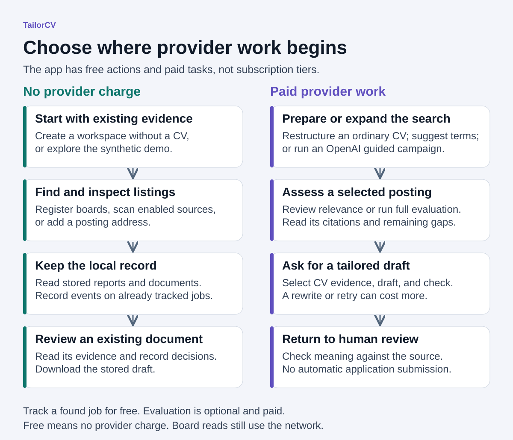
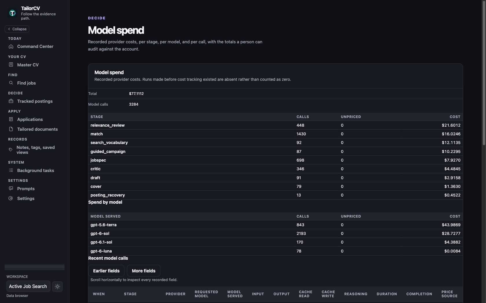
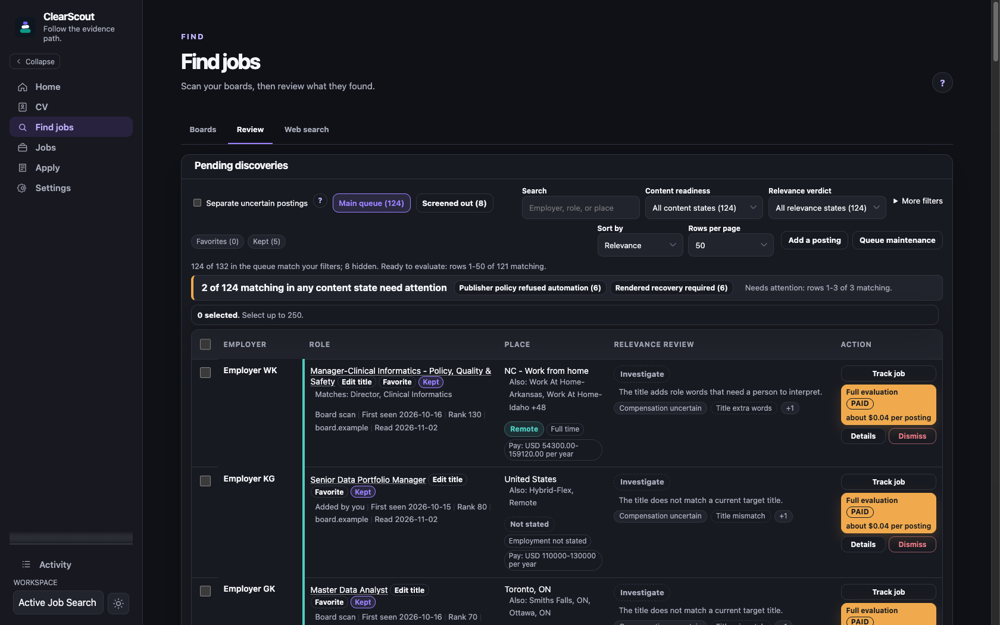
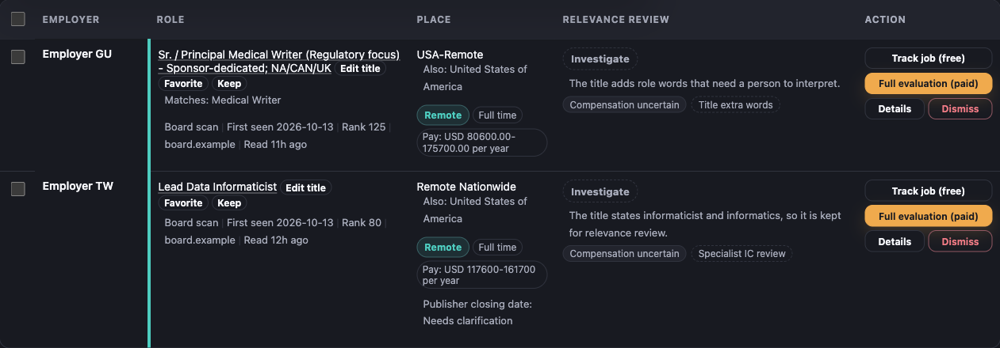
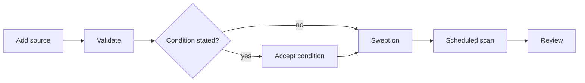
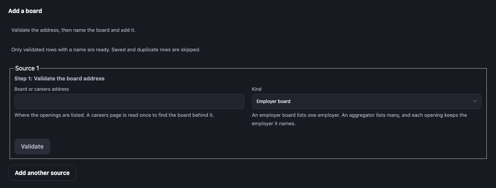
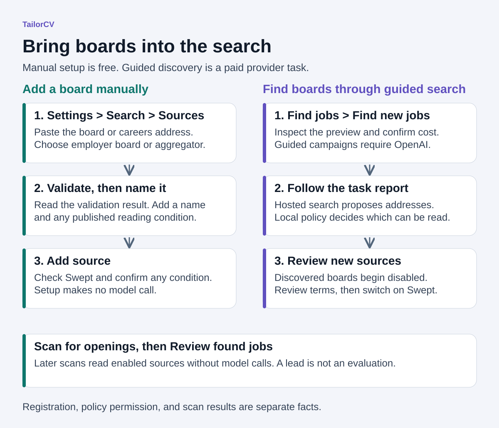
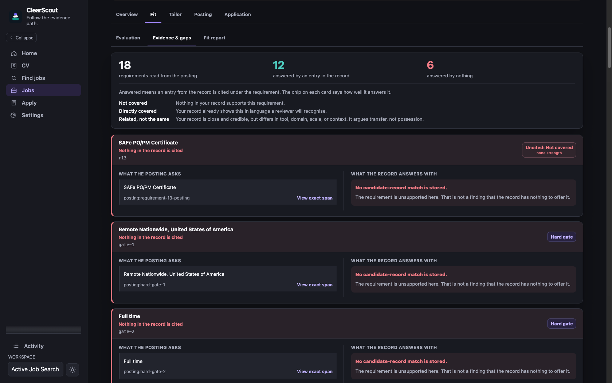
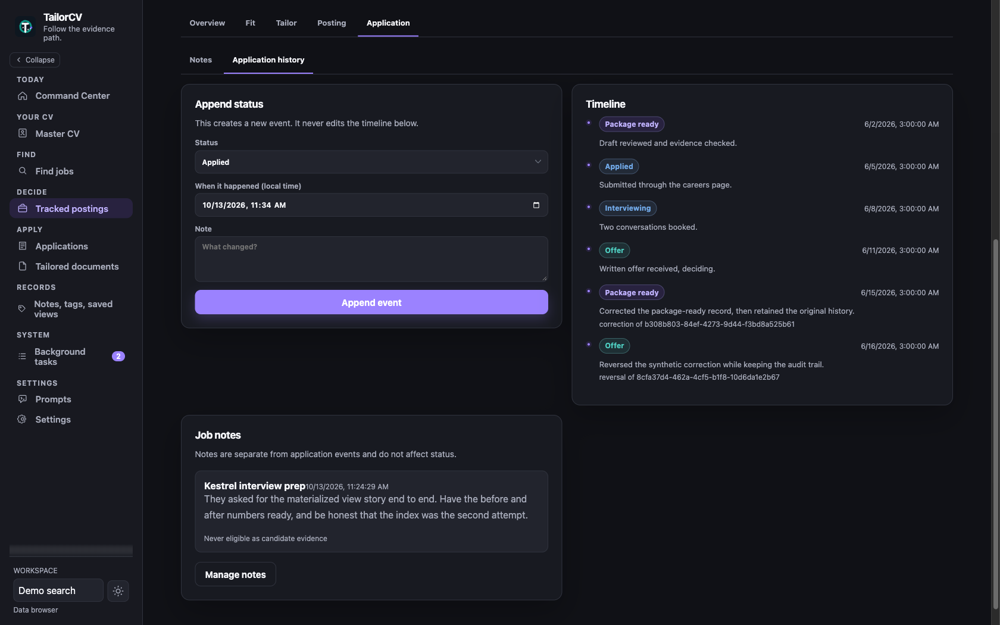

# Use ClearScout locally

Start small. Create one workspace and add one posting. Discovery and manual
tracking need no CV or provider key.

For model help, import a master CV and evaluate one posting. Read the cited
evidence and unanswered requirements before you ask for a draft. Approve only a
proposal you have read. ClearScout records the work. It submits nothing.

The [synthetic product tour](product-tour.md) shows the full evidence path with
no install. Exact flags live in `clearscout --help` and
`clearscout <command> --help`.

## Install the release before using real data

Version 0.1.0 is the first public alpha, a pre-release on
[GitHub Releases](https://github.com/sethstraw/clearscout/releases). Verify and
install its wheel as the [README](../README.md#install-a-tagged-release)
describes. The setup in [CONTRIBUTING.md](../.github/CONTRIBUTING.md) is for
changing ClearScout; a development checkout is not a release. ClearScout is not
on PyPI, and a direct Git install lacks the production web client.

## Initialize one workspace

Pick one of two paths. Each `clearscout init` run creates a new workspace, so
do not run it after creating one in the browser unless you want a second.

The free path creates the workspace in the browser:

```bash
clearscout db upgrade
clearscout start
```

Open the printed URL and create a workspace. No key or CV is needed. Search
setup can be skipped and reopened from Welcome or Settings. You can add posting
links while you decide what to search for.

The CV path creates the database, a workspace, and the master CV in one step.
Ordinary file intake uses your OpenAI or Anthropic API account and can cost
money. Invoking it with an ordinary CV starts paid restructuring without a
separate cost confirmation.

```bash
clearscout init --cv ./Existing_CV.docx --name "My Job Search" --slug my-search
```

Then run `clearscout start`. Init prints the paths of the settings file, master
CV, and database, and how the CV was imported.

Evaluation and drafting need a master CV and provider access.
[Validation status](validation.md#provider-claims-are-deliberately-uneven) says
which provider has run live.
[CV ingestion](validation.md#cv-ingestion-remains-a-limitation) is not yet well
tested across real-world layouts and formats.

The master CV uses ClearScout's standardized Markdown format. Its structure
decides what evaluation, selection, and drafting can see. Start from
`clearscout template`. An accepted file or a finished import does not prove all
your evidence is available.

Keep the source CV somewhere private. Word, PDF, Markdown, plain text, and
images are accepted. An OpenAI or Anthropic API account is separate from a chat
subscription. Init asks for provider access when it needs it. Keep the key out of
commands you share.

A canonical ClearScout Markdown CV is adopted with no model call. Other formats
are extracted, restructured by the provider, then checked for provenance and
lost content. Read the master CV and the import report. A clean import does not
prove every line landed in the right place. An unrecognized section, such as
`## Projects`, stays in the file but is never cited or printed. Put project
work under its role.

`clearscout init --help` shows the data-root, workspace-root, provider, and
config overrides. Keep the database and its artifact root together unless you
mean to split them; backup and relocation need both.
[Storage and portability](storage-and-portability.md) covers those steps.

## Choose the free or paid path

"Free" means no provider charge. A board read still contacts an outside site,
under that site's reading policy. Local-first describes storage. It does not
promise your CV never leaves the machine: paid stages send their selected input
to your provider.



| Task                                                       | Provider charge | What to expect                                                |
| ---------------------------------------------------------- | --------------- | ------------------------------------------------------------- |
| Open the synthetic demo                                    | None            | Invented records, without any external request                |
| Adopt a canonical Markdown or text CV                      | None            | Existing ClearScout structure is retained                     |
| Import Word, PDF, images, or non-canonical text            | Paid            | STRUCTURE and INGEST calls, then an import report             |
| Save a master CV edit the canonical parser accepts         | None            | A new version with your text                                  |
| Save a master CV edit the canonical parser rejects         | Paid            | A STRUCTURE call with no dialog; fails with no key set        |
| Edit search settings or register a source                  | None            | Local settings; validation may read the source website        |
| Preview, revalidate, schedule, scan, or continue a source  | None            | External reads under the source policy                        |
| Add posting URLs, refresh postings, or rescreen the queue  | None            | Deterministic reads and screening                             |
| Retry a guided campaign's board reads                      | None            | Local reads of addresses already found                        |
| Track a found job and record your priority, fit, and note  | None            | Saved discovery and your own judgment                         |
| Read reports, edit notes, or record events on tracked jobs | None            | Existing local records and history                            |
| Edit prompts, rule on requirements, view spend, preflight  | None            | Local records and estimates                                   |
| Refresh the price table                                    | None            | A web read of published prices                                |
| Verify an artifact or render a document                    | None            | Local checks, or your external render command                 |
| Upload files actually submitted with an application        | None            | Exact local bytes, labeled separately from drafts             |
| Suggest search vocabulary                                  | Paid            | CV-grounded search terms; no web search                       |
| Find new jobs with a guided campaign                       | Paid            | OpenAI hosted search, then local reads                        |
| Review relevance on selected postings                      | Paid            | RELEVANCE_REVIEW, up to 20 postings per call                  |
| Evaluate a posting                                         | Paid            | JOBSPEC and MATCH; free when a rule refuses first             |
| Recover posting content with model assistance              | Paid            | POSTING_RECOVERY and up to two hosted searches                |
| Re-check disputed requirements                             | Paid            | One JOBSPEC or MATCH call; see the section below              |
| Compare postings in a batch                                | Paid            | JOBSPEC and MATCH per posting                                 |
| Tailor a resume and cover letter                           | Paid            | JOBSPEC, MATCH, DRAFT up to 3 tries, COVER, CRITIC            |
| Build an approved derivative                               | Paid            | The tailoring stages; an exact reused package is free         |
| Retry a failed paid task                                   | Paid            | The same stages again                                         |
| Record review decisions or download stored Markdown        | None            | An existing draft; this does not build an approved derivative |

On the CLI, `clearscout discover`, `template`, `doctor`, `report`,
`search show`, `db`, `auth`, `start`, `stop`, `status`, `serve`, and `worker`
are free. `clearscout run`, `screen`, `batch`, `import`, and `tasks tailor` are
paid. `clearscout init --cv` is free for a canonical Markdown or text CV and
paid otherwise. Background tasks run on the OpenAI flex tier and the Anthropic
standard tier. The CLI and CV import run on the standard tier.

A paid task with no key set is queued and fails when it runs. Evaluation and
`clearscout run` need a key even when the response cache would answer.

Nothing the program schedules is paid. Scheduled scans, catch-up scans, and
screening are free. Every paid task starts with a person.
[Re-check disputed requirements](#re-check-disputed-requirements) covers the
paid re-check buttons.

To explore without a provider account, use the
[synthetic workspace](../README.md#try-the-synthetic-workspace). The seed does
not make paid actions free: a new model task still needs a configured provider
and can incur charges.

For a real search with no model charges, create a workspace in the browser and
use manual search setup. Board scans need at least one saved target title.
Posting links need no titles, CV, or key. Register a board for repeated scans;
paste a link to inspect one role. A recognized board is not a promise of a
permitted or complete read. Check its coverage and recovery action, and use
link or published-text intake where allowed.

A CV is optional for discovery. For later evaluation, start with a canonical
CV. `clearscout template` writes the skeleton to `CV_Master.md` in the current
directory, or to a path you pass. Fill it with your own evidence before
importing.

Register boards, scan, and inspect listings. On a pending row, select
**Track job**. It is free, adds the job to **Jobs** as **Not evaluated** with no
model score, and opens its page. Record your own priority, fit, and note in the
overview. On the Application history tab, record the status and its date. The
application's Files page takes the exact resume or cover letter you sent.
Choose a submitted role only for files you actually sent; drafts show
separately.

Pick paid work by the result you need:

- Search vocabulary suggests CV-grounded terms without fetching postings or
  boards. Use it when you want help naming the search.
- A guided campaign searches past your saved boards.
- Relevance review compares a chosen set of readable discoveries with your CV
  and preferences, to pick which deserve a closer look.
- Evaluation links a posting's requirements to CV evidence and reports fit.
- Tailoring drafts a resume and cover letter from selected evidence, then
  checks them. Read every line before approving.

Vocabulary, campaigns, and relevance review need a saved search-parameter
version and a master CV. Evaluation and tailoring need a master CV. All need
provider access and the local worker. Ordinary stages use the OpenAI or
Anthropic adapter; campaigns require OpenAI background web search.

For the first paid result, use one posting. Read the scope and
[cost information](#check-cost-before-approving-work) before confirming.
Estimates advise; they set no ceiling. The Model spend report records calls,
usage, and costs; missing prices stay unknown. Reselecting a reviewed row can
charge again.

## Start ClearScout

```bash
clearscout start
```

This binds the API to loopback, starts the one durable worker on the same data
root, waits for health, and prints the URL. `clearscout status` checks both
processes. `clearscout stop` stops only what `start` launched.

`stop` gives active worker tasks up to 60 seconds, with the API still up. A
worker still running only source scans or artifact checks is then killed; the
task resumes on the next `start` once its lease expires, about a minute later.
A worker running any other task, such as a paid call, is left running and
`stop` names the task; retry once it settles. Then `stop` waits up to 60
seconds for the API, giving open requests 30 seconds. A timeout keeps process
ownership and names the process still stopping. Queued tasks stay queued.

The next `start` reconciles staged artifacts first. `start` runs no
migrations; if the schema is behind, run the database command the error names.
Output goes to `clearscout-serve.log` and `clearscout-worker.log` in the ignored
`.clearscout-runtime` directory under the data root.

To supervise the two services yourself:

```bash
clearscout serve
clearscout worker
```

The worker leases queued work from the same database the server uses. Give
both the same `--data-root` if you override it. One worker per database is
supported; a second is refused. A task stuck in the queue usually means no
worker is running. **Activity** shows its state and any error.

The worker reads board continuations on different hosts in parallel, four at
once by default. Two on the same host take turns. Set
`CLEARSCOUT_CONTINUATION_SLOTS` (1 to 8) before `clearscout start`, or pass
`--continuation-slots` to `clearscout worker`. Ctrl-C on `clearscout worker`
lets running continuations finish; a second Ctrl-C stops at once.

## Finish the setup walkthrough

The browser opens the walkthrough only when no workspace exists, so after
`clearscout init` it goes straight to the app. Free setup has three steps and
starts at the first one not done:

1. Workspace: create a local search record.
2. Search setup: enter preferences, review them, and save one version. You can
   skip it and reopen it from Welcome or Settings.
3. Posting links: add postings to inspect.

Manual search setup covers Role preferences, Places and residence, Working
arrangements, Optional pay preferences, and a final review. In each basic section,
enter the values you mean or choose **No restriction in this section**. Blank fields stay
unstated. The review also shows retained advanced preferences.

Finishing needs at least one target title. **No restriction** in Role
preferences clears limits and exclusions but keeps target titles. You can skip
the walkthrough and use posting links instead.

Answers stay a draft until **Confirm and save preferences**. Residence and work
authorization are separate answers: living somewhere does not grant permission
to work there.

Provider access and CV import are optional links to **Settings > Provider** and
the **CV** page. The server never returns a key to the browser. The browser
sends a new key once; later reads say only whether one is set. The server keeps
it in the operating-system keyring.

Settings tabs are **Search**, **Provider**, **Drafting**, **Costs**,
**Notes & tags**, and **Advanced**. Advanced holds **Prompts**,
**Diagnostics**, and **Posting refusals**. Boards live under
**Find jobs > Boards**. **Settings > Costs** holds the Model spend report. A
missing price is not zero, so totals are withheld when any call has no price.
The report keeps call-level usage, so you can compare it with your provider
account.



## Add one posting before widening the search

Open **Find jobs > Review > Add a posting**. Paste one direct public posting
URL, or several, one per line. The optional title and **Check posting** work on
one link at a time.

Each link gets a free content read under the source policy. The publisher check
and the first read after it read the link even where robots.txt disallows
crawling. They stop only when robots.txt names ClearScout. Every later refresh
honors a disallow. Results list added, duplicate, invalid or unsupported, and
failed links separately. Invalid and failed links stay editable. A saved link
whose read could not be queued stays saved; retry with its free refresh.
Adding a link does not evaluate it or call a model.

### How to choose a link

Sources are for repeated scans. A posting link adds one opening. Choose by what
the page describes, not its hostname. An applicant tracking system (ATS) is the
employer's hiring software. You need not know the vendor, and a board can live
on the employer's domain or the software provider's domain.

| Example                                                                   | Page purpose and where to use it                                                                                                        |
| ------------------------------------------------------------------------- | --------------------------------------------------------------------------------------------------------------------------------------- |
| `https://www.example.com/careers/`                                        | An employer careers landing page. It introduces working there and links to openings. It is not one job. Follow its open-positions link. |
| `https://ats.example.net/example-co`                                      | A job board listing several openings, hosted by the employer's hiring software. Add this as a source.                                   |
| `https://ats.example.net/example-co/jobs/4815162342`                      | One posting that describes a single role. Paste it into posting-link intake.                                                            |
| [ClearScout software repository](https://github.com/sethstraw/clearscout) | Holds this project's code. Its repository URL is not a job posting.                                                                     |

These addresses show shapes only. If a role closes, pick another from its
board.

A search-results URL is a list. A sign-in form alone is not a job description.
A direct application link can work when a reader can recover the posting, but
prefer the description page. Tracking and short links may redirect elsewhere.
A homepage or repository issue is not an opening just because its URL says
jobs. A GitHub page can be a posting if it describes one role.

A recognized board is not a promise of full coverage or permission. Check the
read result and coverage note. When a board cannot be read, add a posting link
or its published text where intake allows.

Find jobs has three tabs:

- **Boards** scans all enabled sources, a selection, or one source. A selection
  can include sources excluded from bulk scans without enabling them. It holds
  **Your boards**, an optional **Scan schedule** with a saved scope, and
  **History**: dated scan and query records and screened-out listings and
  titles, filterable by source and result. Same-day rescans can replace a
  record.
- **Review** is the pending queue. Add posting links, read retained content,
  and track or dismiss for free. Relevance review is a separate paid action.
  Choose **Screened out** in the filter to see postings that conflict with your
  rules.
- **Web search** runs a guided campaign for new postings and boards, and a
  separate search-vocabulary action that proposes terms from cited CV evidence
  and fetches nothing. Each is its own paid task with its own approval and
  cost.

**Settings > Advanced > Posting refusals** keeps refusal history.

A model may propose a source or lead. It cannot override URL, robots,
redirect, rate, or published-condition policy. A board scan sends no CV text or
search parameters. Scheduling calls no model.

Version 0.1.0 has known fit, search, board, cost, progress, and tailoring
limits; see [validation status](validation.md#known-limits-in-010). Treat a
recommendation as a start and read every drafted line.

Evaluate only postings worth it. Evaluation is queued, may call the provider,
and commits the posting, requirements, evidence links, factors, and verdict
together. Read that result before widening the search. A refusal is not a low
score: ClearScout could not make the claim under its rule.





Each **Review** row shows the source, published facts, and screening findings,
plus Favorite and Keep controls, so a row can be judged without opening its
details. A finding can match, refuse, or stay unknown.
Missing or incomplete board facts stay unknown, never a match. Employer, title,
and location from hosted search are unverified hints and drive no screening
until a local read supplies publisher facts. The queue recommendation orders
rows; it is not a fit evaluation.

Select up to 250 eligible discoveries across pages. **Select eligible
discoveries on this page** takes the loaded page only; the confirmation counts
other pages too. **Track selected** is free and reports each result; failures
stay selected. Relevance review and evaluation are separate paid actions.

Use **Favorite** for your best matches and **Keep** when the program misjudged
a row. Favorites sort first, then kept rows. Either marker protects the posting
family from bulk and program dismissals. Confirming a dismissal from the row
itself clears its markers. A one-line keep note gives the relevance reviewer
your reason; it does not change the evidence.

A posting you add by link is not dismissed by a screening or evaluation
refusal. Evaluation still refuses it before any provider call, and it stays in
the queue, where relevance review can read it. It is dismissed when its body
lists no requirements. It leaves the queue when it closes or its evaluation
creates a job. It stays yours when a tracked board later lists it, and that
board's complete read marks it withdrawn once the board drops it. Adding a link
a board already staged does not make it yours.

An aggregator read, such as Himalayas or Arbeitnow, takes a fixed number of the
newest listings. It is never complete, so a missing job is never marked
withdrawn.

Himalayas states when each job stops being listed. Every Himalayas
read withdraws a staged row past that time, and a listing already past it is
never staged. If Himalayas still serves the job after that time, the row stays
withdrawn until a read moves the time forward. The stated time belongs to
Himalayas, so a row another source lists afterwards drops it. A job that closes earlier than stated, or an
aggregator row with no stated expiry, stays queued until you dismiss it or
**Refresh posting** reads it as closed.

The Dismissed panel offers **Restore and keep**. A marked posting that closes
at its source shows as no longer listed and does not count as ready.

Board scans and campaign board reads keep listings that search conditions
refuse, so you can act on them. The queue shows uncertain postings by default
under **Not excluded**. **Screened out** shows rule conflicts and titles the
employer marks "do not apply" or "test requisition". Readable refusals need
your decision, not a refresh. Their bodies stay available, and only you track
or dismiss them.

**Separate uncertain postings** limits the main queue to the pursue route.
**Unconfirmed matches** groups investigate, needs-verification, and
uncertain-pay routes. With the option off, they appear in **Main queue**; see
them through **More filters > Constraint route > Unconfirmed matches**. Counts
include all content states unless you pick a Content readiness filter. The
choice is saved per workspace in this browser and changes only visibility.
Adding a posting briefly shows all routes so its result stays visible; choose
**Main queue** to return.

Text that reads as cut off shows **Needs recovery** (Only part of the posting
was read). That covers short text ending mid-sentence, and text the latest
relevance review found too short. Full evaluation skips it at no cost. Attach
the full text or find the employer's page first. Text you attach is never read
as cut off.

Unconfirmed facts need no paid evaluation. Track is free. Full evaluation and
new model drafts remain optional paid actions.

Extracted pay stays visible but never confirms or refuses your pay preference.
Check the quoted range. A labelled range under 200 with no period word, such as
"Pay range: $45 - $61", reads as hourly. When a posting lists a Primary
Location range beside other ranges in the same country, the Primary Location
range is read. Refreshing unchanged text keeps the uncertainty. No extracted
pay means none was confirmed.

Filters apply to the whole queue before paging. Each filter's counts respect
the other filters, each lane states its range and total, and the newer-rows
banner uses the same filters. Under **Find jobs > Boards > History**, the
collapsed **Screened out in latest scans** table counts each source's
screened-out listings from its latest scan, with a review link.

Relevance states such as High relevance, Needs closer look, Low relevance, and
Not yet reviewed order the queue. Full evaluation uses separate decisions such
as `apply_now` and `deprioritize`, reserved for the evidence-backed fit report.

Relevance review takes any chosen pending discoveries, however they arrived.
It charges for every readable row, including ones already reviewed under the
current parameters, and nothing for unreadable rows. Past reviews keep their
core-work and qualification judgments, condition status, posting and CV
citations, and open questions. Use an evaluation for a fresh assessment.

Stated unwanted work can yield an `unlikely` verdict when the reviewer reads it
as the posting's defining work. An incidental mention is not meant to count.
That reading is the model's; no program check confirms it. The review keeps the
posting citations behind it.

Campaigns and board scans each report a funnel audit: candidates proposed,
boards read, and candidates that reached screening and staging. Each refusal or
omission has a typed reason. A staged direct link does not count as read.
Detailed outcomes are capped for display; full counts and the omitted count
stay visible. A search-vocabulary run proposes nothing, so its audit is empty.

## Add boards and scan them on a schedule

Every step here is free. Boards are read under their published policy with no
model call.

1. Save at least one target title under **Settings > Search** (Target titles).
2. Open **Find jobs > Boards**. Under **Your boards > Add a board**, paste the
   **Board or careers address**. A posting link from the board also works;
   [How to choose a link](#how-to-choose-a-link) shows the shapes.
3. Choose **Validate** to preview what ClearScout can read.
4. Enter the employer name. To record a published reading condition, open
   **Advanced: reading condition** and fill **Condition on reading it**. Choose
   **Add source**.
5. Switch on **Swept**. A source with a condition shows it first and waits for
   you to accept.
6. Under **Scan schedule**, open **Set up a scan schedule**. Choose daily or
   weekly, a local time, and a named time zone such as `Europe/London`.
7. Keep the worker running. Scheduled scans run only while it runs. After a
   shutdown, one catch-up scan runs on the next start.
8. Review new postings under **Find jobs > Review**.



## Schedule free board scans

**Find jobs > Boards > Scan schedule** holds one optional daily or weekly
schedule per workspace. Choose a local time and IANA time zone; weekly also
needs a weekday. Save target titles first.

**All enabled sources at each run** follows your source settings. For a fixed
subset, select sources in the manual scan table, choose **Saved source
selection**, then **Use current source selection**, and save. It can include
sources excluded from bulk scans. Later manual selections do not change it.
Unavailable saved sources stay listed and are skipped until available or
replaced.

The schedule runs only while the worker runs. Enabling or resuming starts at
the next future time. After a shutdown, an overdue schedule queues one catch-up
scan, not every missed run. A repeated local time runs at its first occurrence.
A time skipped by a clock change shifts forward by the gap.

**Pause schedule** stops future scans. Active scans continue; cancel them in
**Activity**. Resuming does not catch up runs missed while paused. Check the
calendar, next run, and last task or error before leaving.

## Add a board manually

Open **Find jobs > Boards**. A source is a board or careers page, not one job's
application form.



1. Under **Your boards > Add a board**, paste its **Board or careers address**.
2. Choose **Employer board** for one employer, or **Aggregator** for a site
   listing several.
3. Choose **Validate**. ClearScout reports what it can read. Changing the
   address or kind needs validation again.
4. Enter a name under **Step 2: Name the board**. To record a published reading
   condition, open **Advanced: reading condition** and fill **Condition on
   reading it** and **Published at**. Leave them blank if unchecked; blank does
   not mean permission.
5. Choose **Add source** and check **Swept**. If the source states a condition,
   confirm it before the scan is enabled.
6. Scan all enabled sources, select some and choose **Scan selected sources**,
   or use one source's Scan control. Check the scope, result, and read history.
   New candidates appear under **Review**.

Source setup and scans call no model. A recognized platform does not promise a
readable or complete board; check observed coverage. A failed, refused, or
partial read does not mean zero openings. Repeated scans do not establish
permission.

Read history is not a lifetime tally; same-day rescans can replace records. A
continuation reports its own counts, and an unknown total stays unknown while
the read is incomplete.

For a retained posting, **Refresh posting** reads it with no model.
**Attach posting text** takes text you got from the posting and confirms it
belongs to that link. Both are free and follow reading policy. **Estimate
assisted recovery** previews a paid step; **Run assisted recovery** asks for
confirmation and may not recover the full posting.



## Add boards through guided search

Guided search finds new addresses when your boards do not cover the search. It
needs the OpenAI adapter's background-response support.

1. Save search parameters under **Settings > Search**.
2. Open **Find jobs > Web search** and read the campaign preview.
3. Read its scope and cost information, and confirm only the campaign you
   mean. Search vocabulary is a separate paid action.
4. Follow the task under **Activity**. Its report separates proposed
   addresses, local reads, admitted candidates, and refusals.
5. Review candidates under **Find jobs > Review**. A search hint is not a
   verified fact or an evaluation.
6. Under **Find jobs > Boards > Your boards**, read the new boards and any
   conditions. They start disabled. Switch on **Swept** for those you want
   scanned.

A board is registered only when at least one listing reaches the queue. One
that lists nothing, or whose listings all screen out, is reported unresolved
and not registered. The campaign's read and a later scan are separate.

## Read the evidence, not only the score

**Jobs** shows the stored verdict and its factors. Open a posting to see the
requirement text, source span, CV evidence, open questions, and policy version.

**Search jobs** finds an employer, role, location, scope, or rationale. It
ignores case and treats wildcards literally. The employer filter takes several
employers; its counts ignore that selection but keep the other filters.

Scores order work under the saved policy. They do not measure employability or
predict an interview. Each requirement is answered by a cited record entry or
by nothing. A chip rates the match: "Directly covered", "Covered, worded
differently", "Related, not the same", "A fact you state", or "Not covered". An
uncited requirement is unsupported. That does not mean the record has nothing
for it. [Truth and provenance](truth-and-provenance.md) gives the full rules,
including abstention and supersession.



An uncited requirement stays unsupported even when the rest is strong. The
employer name in this image is replaced with a label.

You can rule on each requirement as met, not applicable, or disputed. A fit
dispute says the CV does answer it. An extraction dispute says it was read
wrongly from the posting. A fifth value, reversed, is set only by the paid
re-check below, and always appears in the audit trail with the cited quote.

## Re-check disputed requirements

A job page shows a free Refresh posting button unless archived. It re-fetches
the body with no model call. Two paid buttons can appear beside it, never on an
archived job:

- Refresh with dispute re-extraction, when re-extraction is enabled and the
  posting has an active extraction dispute.
- Refresh with fit re-match, when fit re-match is enabled and the posting has
  an active fit dispute.

Both are off by default. Turn them on under **Settings > Advanced >
Diagnostics**, in the Learning-loop signals panel's **Re-check disputed
requirements** section: **Enable dispute re-extraction**, **Enable fit
re-match**, then **Save dispute settings**.

Each paid action opens the spend-confirmation dialog. Re-extraction runs one
extraction call on the new body and reverses only when the cited quote passes
the normalized-substring check. Fit re-match runs one match call on the current
master CV and reverses only when it cites a durable CV entry key the prior
match for that requirement did not. Otherwise the dispute stands and no
reversal event is written. Every reversal writes an audit event.

## Tailor only from selected evidence

From a tracked posting, start tailoring when the evidence and guardrails look
right. The pipeline selects CV entries within the document budget, drafts
against those identifiers, verifies the result, and records every stage.

The proposal can hold only claims the selected entries support. Titles,
employers, dates, education, and publication citations are copied by the
program, not rewritten by a model. If the posting asks for something the CV
does not show, amend the master CV with the discovery prompt or leave the gap.
The discovery prompt calls no model.

A master CV edit the canonical parser accepts saves a new version with no model
call. One it rejects, such as one with no dated role or with list markers run
together, goes through import: a paid STRUCTURE call with no cost dialog. With
no key set, the save fails validation.

## Walk through a synthetic application

Open the seeded workspace from the README. This reads existing records and
needs no provider account.

1. Open **Jobs** and the Kestrel Freight Systems posting. Its score is 88, but
   the evidence view keeps unsupported requirements.
2. Read a requirement beside its CV evidence. For an unsupported one, check the
   posting text rather than trusting the score.
3. Open **Apply > Documents**, choose **Open job files**, and inspect the
   stored resume draft on the job's **Tailor > Files** tab. Follow its cited CV
   identifiers. Check qualifications, ownership, and numbers against the
   source; citation checks cannot judge every meaning.
4. Open the draft and read its **Approval review** section. The demo keeps the
   original draft and the accept, replace, and reject decisions. Downloading it
   does not apply them or make it an approved resume.
5. Open **Apply > Applications** and inspect the corrections and reversals. A
   status change appends history instead of erasing the earlier event.

The demo holds prewritten results. It shows review and record keeping, not a
live model's quality or an approved-document build. On a real posting,
evaluation and tailoring are paid. The [product tour](product-tour.md) follows
the same chain. The
[hybrid journey test](../tests/durability/test_workflow_hybrid_journey.py) is
contributor evidence for the offline path.

## Approval names exact bytes

Review the Markdown proposal and its evidence before approval. You may edit the
wording, but the evidence checks run again and you cannot widen the selected
evidence. Approval names the exact proposal digest. If the bytes change, the
approval no longer applies.

The approved Markdown is ClearScout's deliverable. An explicit render request
can call a compatible external command and verify the returned artifact.
ClearScout does not bundle or depend on `pressume`.

## Check cost before approving work

Read the cost history beside each paid action. Past costs help plan a run; they
do not authorize it. A missing price is not a free call. Costs never stop an
approved task. A retry can add charges, so review retained results before
repeating the work.

In the web client, paid background tasks ask first. Other paths do not:
`clearscout tasks tailor`, a direct `POST /api/v1/tasks`, an API retry of a
failed paid task, and `clearscout init` with an ordinary CV all start paid work
with no confirmation. Check provider billing before using them.

The browser CV import's note treats only `.md` and `.markdown` as free. The
server also adopts a canonical `.txt` CV with no model call. The import shows a
note, not a confirmation dialog.

### Typical costs

The eval findings measured these on specific models and dates. They vary with
model, tier, and posting.

Screening cost about USD 0.09 per posting warm on the first full baseline. A
complete application cost a mean of about USD 0.29. The flex tier ran at half
the standard rate, and unattended work runs on flex. Relevance review batches
up to 20 postings per call, with the CV evidence sent once.
[What live runs cost and taught](../evals/FINDINGS.md#cost-economics) has the
detail.

Full evaluation and re-evaluation show an advisory estimate before
confirmation: costs at the configured rates, a modeled range for one attempt,
each posting's unavailable reasons, and the price source. Past output-token
samples set the expected amount; without them it is unavailable, though the
range may still show. The price table has one date: the bundled table's release
date or the date a refresh fetched it. A hand-entered or overridden rate has no
date. Other paid actions show their recorded cost history.

Estimates are not ceilings. Refreshed content, retries, and repairs can exceed
the range. Preparing an estimate makes no provider or publisher request and
does not refresh prices.

API routes:

- `POST /api/v1/workspaces/{workspace_id}/evaluation-preflight` with
  `job_posting_ids` or `pending_discovery_ids`. One item uses the batch
  contract.
- `GET /api/v1/workspaces/{workspace_id}/spend-history` for run history.
- `/api/v1/openapi.json` for the full contract.
- `POST /api/v1/billing/prices/refresh` and
  `POST /api/v1/billing/openai/reconciliation`. Both are POST, not GET.

Recorded costs use returned usage and configured prices. Hosted-search content
charges may be missing from that usage, and invoices may differ. Search
vocabulary and campaign web search need explicit consent; source scans stay
free.

A campaign preview lists every coverage branch, when each was last searched,
and the planned attempts. Its estimate comes from earlier priced attempts on
the same provider and model, or every completed campaign when none match. The
planned hosted-search fee is shown beside it. Every planned attempt runs. A
campaign that used more hosted searches than planned still finishes and warns
of the overrun.

### What one real search has cost

These figures come from the maintainer's job search in September 2026. Work ran
on OpenAI's flex tier, with gpt-6-sol for most stages and gpt-5.6-terra for
campaigns; search vocabulary ran on standard. Prices and models change, so read
these as orders of magnitude.

The table covers two weeks: research, scanning, review, evaluation, and
tailoring. Those weeks also held testing of ClearScout itself, which spent
several times this. So each posting counts once at its measured unit cost, and
test-only campaigns are left out.

| Work                                      | Count in two weeks       | Measured unit cost (USD) | Cost (USD)   |
| ----------------------------------------- | ------------------------ | ------------------------ | ------------ |
| Scanning registered job boards            | 395 scans                | free, no model call      | 0            |
| Search vocabulary                         | 7 calls                  | as recorded              | 0.32         |
| Guided campaigns (hosted web search)      | 2 campaigns, 23 attempts | 0.09 an attempt          | 2.06         |
| Relevance review of new postings, batched | 293 postings             | 0.005 a posting          | 1.46         |
| Recovering unreadable postings            | 8 postings               | 0.03 a posting           | 0.24         |
| Evaluating tracked postings               | 73 postings              | 0.018 to 0.032 a posting | 1.29 to 2.36 |
| Tailoring a resume and cover letter       | 8 postings               | 0.08 to 0.21 a posting   | 0.64 to 1.68 |
| Total                                     |                          |                          | 6 to 8       |

Scans and campaigns found 802 postings. 293 reached a paid review; free rules
or a person settled the rest, or they were still waiting. Hosted-search fees
may sit outside the recorded usage, as noted above.

Two things moved cost most. The flex tier cost roughly 40 percent less than
standard for the same work, but answered slower. Batching mattered as much: a
relevance review sends many postings in one request with the CV evidence once.
Sending one posting per request cost about four times as much. Provider caching
is separate and not guaranteed.

A relevance review's cached prefix holds its instructions, response schema,
search parameters, and CV evidence, and names no posting. A later review with
the same CV, parameters, prompts, and model can read it from cache. In one
measured pair a minute apart, each reviewing four openings the other did not,
the second read its whole prefix from cache and cost about 40 percent of the
first. The cache can still miss, and changing any of those inputs starts a new
prefix.

The estimate beside a paid action averages past calls of that stage. A run
shaped unlike that history, such as one posting per request where history holds
batches, can land well off it.

## Record applications without rewriting history

An application begins when you record an application event. Status, notes,
attachments, and corrections append to the local ledger. A correction points at
the event it supersedes instead of deleting it.

Archiving hides a job from ordinary views but erases nothing. Any job can be
archived. Restoring it brings back its applications, artifacts, and
evaluations.



The timeline shows the correction and reversal beside the original events.
Every identity, date, status, and note here comes from the synthetic demo seed.

## Know which actions leave the machine

Reading the database, reports, artifacts, and browser views is local.
[Security](../.github/SECURITY.md#what-leaves-your-computer) lists each action
that reaches the network. Those can leave provider responses, artifacts, and
usage records behind, so read
[Privacy and retention](privacy-and-retention.md) before using a real CV.

## Diagnose before changing storage

`clearscout doctor` checks configuration, the master CV, credentials, and
storage without a model. `clearscout db status` says whether the database
matches the installed build. Upgrade (which also creates a new database),
import, backup, cache archiving, and downgrade are explicit `clearscout db`
commands, because startup must not change durable state.

If the CLI exits with an error, read the message before retrying. Help and
successful commands return zero; command, configuration, policy, and provider
failures return non-zero. The CLI help is the exact command surface.

## Read the learning-loop signals in Diagnostics

The Learning-loop signals panel under **Settings > Advanced > Diagnostics**
shows three readings of whether the workspace's history is improving later
runs. The same section shows service health, links to **Activity** and the
**Data browser**, and holds the API playground. Each signal is a numerator over
a denominator. The panel shows a percentage when the denominator is non-zero
and "no data yet" otherwise, so an empty workspace does not read as a bad
number. Opening the panel reads rows on demand and schedules nothing.

- Rejected identities re-proposed: share of open search-title, employer-kind,
  and capability-cluster proposals whose identity you already rejected.
- Master CV proposals accepted: share of master-CV entry proposals accepted.
- Top 10 pending matching missed requirements: share of the top ten pending
  discoveries whose title or location mentions a requirement the CV leaves
  unanswered.

## Limits that remain

[Validation status](validation.md) says what has and has not been tested,
including which provider has run live.
